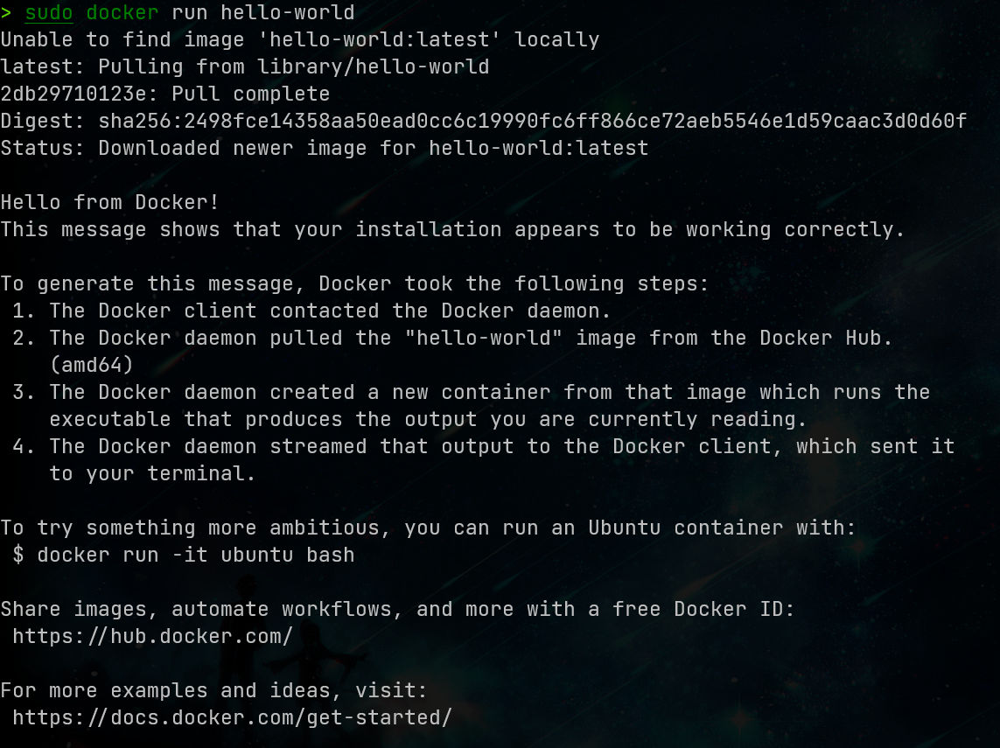
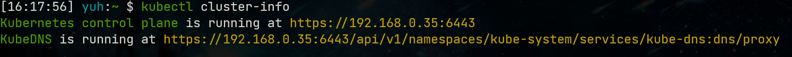

# WSL2 部署 KubeEdge {#wsl2-ubuntu2204kubeedge}

## 安装docker
### 安装基本工具
```shell
sudo apt-get install -y \
	net-tools \
	vim \
	ca-certificates \
	curl \
	gnupg \
	lsb-release \
	apt-transport-https
```
### 添加 Docker 官方 GPG 密钥：
```shell
sudo curl -fsSL https://download.docker.com/linux/ubuntu/gpg | sudo gpg --dearmor -o /usr/share/keyrings/docker-archive-keyring.gpg
```
### 设置存储库
```shell
echo \
  "deb [arch=$(dpkg --print-architecture) signed-by=/usr/share/keyrings/docker-archive-keyring.gpg] https://download.docker.com/linux/ubuntu \
  $(lsb_release -cs) stable" | sudo tee /etc/apt/sources.list.d/docker.list > /dev/null
```
换源后不要忘记更新列表
```shell
sudo apt-get update 
```
查看可安装的版本，此步可选
```shell
sudo apt-cache madison docker-ce
```
### 安装docker
```shell
sudo apt-get install docker-ce docker-ce-cli containerd.io docker-compose-plugin 
```
### 配置加速
需要将注释删除
```shell
sudo mkdir -p /etc/docker
sudo tee /etc/docker/daemon.json <<-'EOF'
{
  "registry-mirrors": ["https://82m9ar63.mirror.aliyuncs.com"],
  "exec-opts": ["native.cgroupdriver=systemd"], #注意：node节点的驱动为cgroupfs
  "log-driver": "json-file",
  "log-opts": {
    "max-size": "100m"
  },
  "storage-driver": "overlay2"
}
EOF
```
### 应用配置并重新启动docker：
```shell
sudo systemctl daemon-reload
sudo systemctl restart docker
sudo docker run hello-world		#检查是否安装成功（即显示"Hello from Docker!...")
```
结果如下则是成功安装了docker

## kubenetes安装
### 准备工作
关闭防火墙和磁盘交换分区：

（新装的系统没有开防火墙（可在参考文档中查找方法），本文只说明关闭防火墙的方法。）
（这个不知道啥意思。。。）
这里`/etc/fstab`中没有配置先不管
```shell
sudo swapoff -a		#关闭交换分区
sudo vim /etc/fstab	# 注释掉swap分区那一行，永久禁用swap分区
```
网络设置：
设置2个k8s.conf文件，允许 iptables 检查桥接流量：
```shell
cat <<EOF | sudo tee /etc/modules-load.d/k8s.conf
br_netfilter
EOF

cat <<EOF | sudo tee /etc/sysctl.d/k8s.conf
net.bridge.bridge-nf-call-ip6tables = 1
net.bridge.bridge-nf-call-iptables = 1
EOF

sudo sysctl --system	#应用设置

```
下载公开签名秘钥并添加阿里云镜像源：
```shell
sudo curl https://mirrors.aliyun.com/kubernetes/apt/doc/apt-key.gpg | sudo apt-key add -
sudo cat <<EOF >/etc/apt/sources.list.d/kubernetes.list
deb https://mirrors.aliyun.com/kubernetes/apt/ kubernetes-xenial main
EOF
sudo apt-get update
```
### 开始安装kubenetes：
这里建议用1.23以下的版本，不然后面初始化不好过
```shell
sudo apt-get install -y kubelet=1.20.2-00 kubeadm=1.20.2-00 kubectl=1.20.2-00
sudo systemctl enable --now kubelet		#使服务生效
```
初始化：
--apiserver-advertise-address=192.0.2.10 \
        --control-plane-endpoint=192.0.2.10 \
写自己的ip地址
```shell
sudo kubeadm init \                                                                                                                                                    ok  37s  14:52:13
        --apiserver-advertise-address=192.0.2.10 \
        --control-plane-endpoint=192.0.2.10 \
        --image-repository  registry.cn-hangzhou.aliyuncs.com/google_containers --kubernetes-version v1.20.2 \
        --service-cidr=192.0.2.10/12 \
        --pod-network-cidr=192.0.2.10/16
```
初始化主节点master：
在/etc/hosts中设置地址映射：
配置
```shell
mkdir -p $HOME/.kube
sudo cp -i /etc/kubernetes/admin.conf $HOME/.kube/config
sudo chown $(id -u):$(id -g) $HOME/.kube/config
export KUBECONFIG=/etc/kubernetes/admin.conf

-------- root cause:
$ export KUBECONFIG=/etc/kubernetes/admin.conf
the owner of /etc/kubernetes/admin.conf is root.

------- workaround:
$ export KUBECONFIG=$HOME/.kube/config
```
查看是否成功
```shell
kubectl cluster-info
```

