# Linux 内核概述 {#linux-}

## 内核范型
**微内核**
只有最基本的功能直接由中央内核（即微内核）实现。所有其他的功能都委托给一些独立进程，这些进程通过明确定义的通信接口与中心内核通信。例如，独立进程可能负责实现各种文件系统、内存管理等。
**宏内核**
内核的全部代码，包括所有子系统（如内存管理、文件系统、设备驱动程序）都打包到一个文件中。内核中的每个函数都可以访问内核中所有其他部分。如果编程时不小心，很可能会导致源代码中出现复杂的嵌套。

Linux属于宏内核
## 内核构成
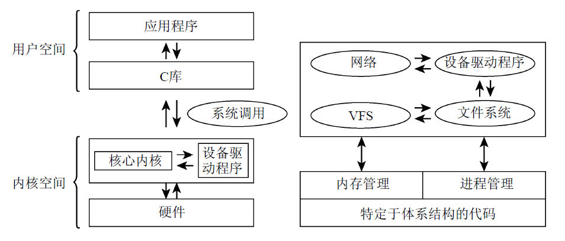
上图概述了组成完整Linux系统的各个层次，以及内核所包含的一些重要子系统。
### 进程、进程切换、调度
**进程:**传统上，UNIX操作系统下运行的应用程序、服务器及其他程序都称为进程。
系统中同时真正在运行的进
程数目最多不超过CPU数目，因此内核会按照短的时间间隔在不同的进程之间切换（用户是注意不到的），这样就造成了同时处理多进程的假象。
**进程切换**：内核借助于CPU的帮助，负责进程切换的技术细节。必须给各个进程造成一种错觉，即CPU总是可用的。通过在撤销进程的CPU资源之前保存进程所有与状态相关的要素，并将进程置于空闲状态，即可达到这目的。在重新激活进程时，则将保存的状态原样恢复。**进程之间的切换称之为进程切换。**
**调度：**内核还必须确定如何在现存进程之间共享CPU时间。重要进程得到的CPU时间多一点，次要进程得到的少一点。**确定哪个进程运行多长时间的过程称为调度**。
### UNIX进程
Linux对进程采用了一种层次系统，每个进程都依赖于一个父进程。内核启动init程序作为第一个进程。
**fork**
创建当前进程的一个副本，父进程和子进程只有 PID（进程 ID）不同。Linux 利用写时复制（copy on write），主要的原理是将内存复制操作延迟到父进程或子进程向某内存页面写入数据之前，在只读访问的情况下父进程和子进程可以共用同一内存页。

**exec**
将一个新程序加载到当前进程的内存中并执行。旧程序的内存页将刷出，其内容将替换为新的数据。然后开始执行新程序。
### 地址空间与特权级别
Linux将虚拟地址空间划分为两个部分，分别称为内核空间和用户空间
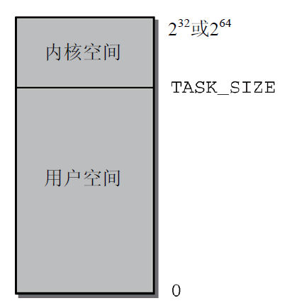
系统中每个用户进程都有自身的虚拟地址范围，从0到TASK_SIZE。用户空间之上的区域（从TASK_SIZE到2^32或2^64）保留给内核专用，用户进程不能访问。TASK_SIZE是一个特定于计算机体系结构的常数，把地址空间按给定比例划分为两部分。
**内核空间**
内核专用，用户进程不能访问
**用户空间**
用户进程可访问，每个用户进程独立，相互之间不能访问
#### 特权级别
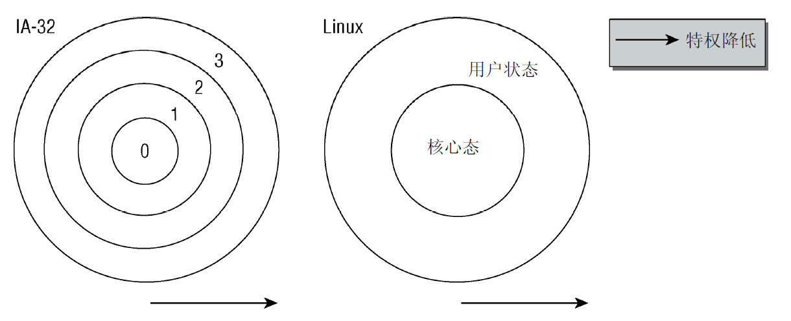
所有的现代 CPU 都提供了几种特权级别，每个特权级别都有各种限制，例如对执行某些汇编语言指令或访问虚拟地址空间某一特定部分的限制。Linux 系统实际只用到了两种。
用户进程需要执行特权指令需要通过操作系统提供的系统调用。
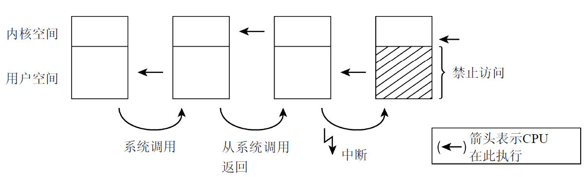
在核心态和用户状态执行。CPU 大多数时间都在执行用户空间中的代码。当应用程序执行系统调用时，则切换到核心态，内核将完成其请求。在此期间，内核可以访问虚拟地址空间的用户部分。在系统调用完成之后，CPU 切换回用户状态。硬件中断也会使 CPU 切换到核心态，这种情况下内核不能访问用户空间，因为正在运行的进程被强行打断，这个中断处理程序实际上与被中断的进程无关。

#### 地址空间
64 位机需要管理的虚拟地址空间会很大，实际的物理内存不会有这么多，一般实际可寻址范围设置在 42 或 47，该值仍然大于计算机上实际可能的内存数量，因此是完全够用的。
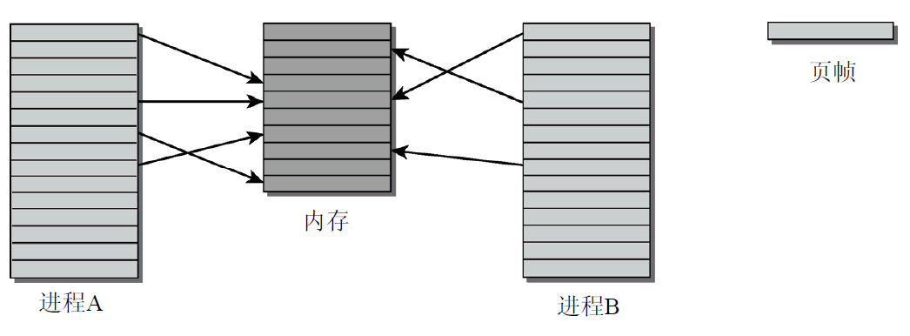
比如该图中进程的虚拟地址空间比实际的物理内存还要大。
### 页表 
用来将虚拟地址空间映射到物理地址空间的数据结构称为页表。
因为虚拟地址空间的大部分区域都没有使用，因而也没有关联到页帧，那么就可以使用功能相同但内存用量少得多的模型：多级分页。
Linux也采用了四级页表。
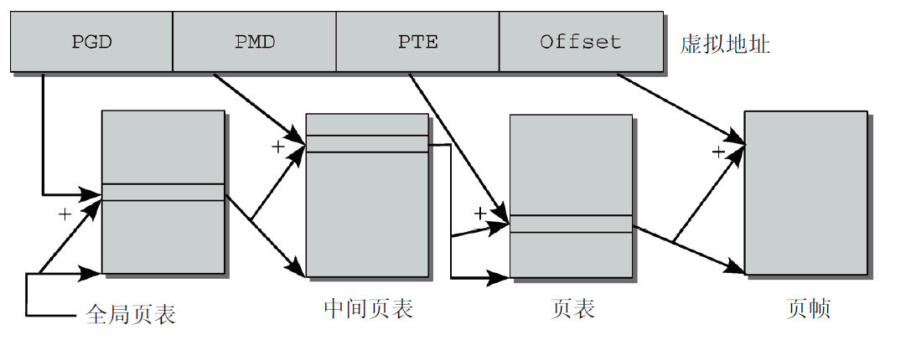
虚拟地址的第一部分称为全局页目录（Page Global Directory，PGD）。PGD用于索引进程中的一个数组（每个进程有且仅有一个），该数组是所谓的全局页目录或PGD。PGD的数组项指向另一些数组的起始地址，这些数组称为中间页目录（Page Middle Directory，PMD）。
虚拟地址中的第二个部分称为PMD，在通过PGD中的数组项找到对应的PMD之后，则使用PMD来索引PMD。PMD的数组项也是指针，指向下一级数组，称为页表或页目录。
虚拟地址的第三个部分称为PTE（Page Table Entry，页表数组），用作页表的索引。虚拟内存页和页帧之间的映射就此完成，因为页表的数组项是指向页帧的。
虚拟地址最后的一部分称为偏移量。它指定了页内部的一个字节位置。归根结底，每个地址都指向地址空间中唯一定义的某个字节。
页表的一个特色在于，对虚拟地址空间中不需要的区域，不必创建中间页目录或页表。与前述使用单个数组的方法相比，多级页表节省了大量内存。
#### 与CPU的交互
对于只支持二级或三级页表的CPU来说，内核中体系结构相关的代码必须通过空页表对缺少的页表进行仿真。因此，内存管理代码剩余部分的实现是与CPU无关的。
#### 内存映射
内存映射是一种重要的抽象手段。在内核中大量使用，也可以用于用户应用程序。映射方法可以将任意来源的数据传输到进程的虚拟地址空间中。
### 物理内存的分配
在内核分配内存时，必须记录页帧的已分配或空闲状态，以免两个进程使用同样的内存区域。由于内存分配和释放非常频繁，内核还必须保证相关操作尽快完成。内核可以只分配完整的页帧。将内存划分为更小的部分的工作，则委托给用户空间中的标准库。标准库将来源于内核的页帧拆分为小的区域，并为进程分配内存。
#### 伙伴系统
内核中很多时候要求分配连续页。
系统中的空闲内存块总是两两分组，每组中的两个内存块称作伙伴。伙伴的分配可以是彼此独立的。但如果两个伙伴都是空闲的，内核会将其合并为一个更大的内存块，作为下一层次上某个内存块的伙伴。
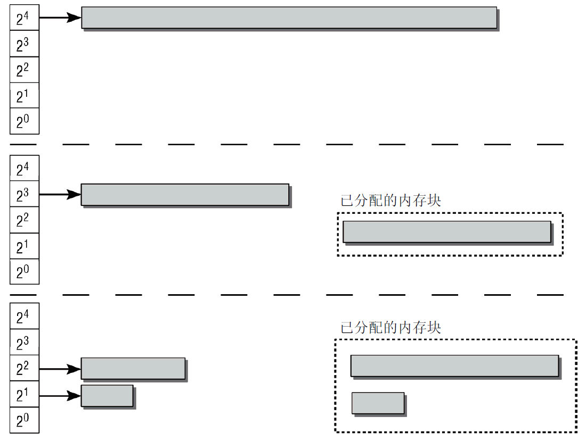]]
如果系统现在需要 8 个页帧，则将 16 个页帧组成的块拆分为两个伙伴。其中一块用于满足应用程序的请求，而剩余的 8 个页帧则放置到对应 8 页大小内存块的列表(空闲内存列表)中
如果下一个请求只需要 2 个连续页帧，则由 8 页组成的块会分裂成 2 个伙伴，每个包含 4 个页帧。其中一块放置回伙伴列表中，而另一个再次分裂成 2 个伙伴，每个包含 2 页。其中一个回到伙伴系统，另一个则传递给应用程序。
在应用程序释放内存时，内核可以直接检查地址，来判断是否能够创建一组伙伴，并合并为一个更大的内存块放回到伙伴列表中，这刚好是内存块分裂的逆过程。这提高了较大内存块可用的可能性。
#### slab缓存
内核本身经常需要比完整页帧小得多的内存块。由于内核无法使用标准库的函数，因而必须在伙伴系统基础上自行定义额外的内存管理层，将伙伴系统提供的页划分为更小的部分。该方法不仅可以分配内存，还为频繁使用的小对象实现了一个一般性的缓存——slab缓存。
伙伴系统使用页作为最小单位，实际上是一种页管理策略。内核本身经常需要比完整页帧小得多的内存块，这种情况不适合直接使用伙伴系统。
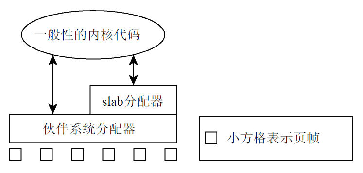
在伙伴系统上定义一个 slab 分配器，为内核代码提供类似 malloc 和 free 的以字节为最小单位的内存分配器，该方法名为 kmalloc 和 kfree。当 slab 分配器收到分配指令时如果缓存不足，就会向伙伴系统申请页帧，用这个页填充自己的缓存，再从自己的缓存中为请求者分配内存，用于实现分配请求。
#### 页面交换和页面回收

 页面交换通过利用磁盘空间作为扩展内存，从而增大了可用的内存。
当要访问的页存在于硬盘的交换空间中时，内核通过识别页表标志位并利用缺页异常将页换回内存，该操作对应用程序透明
### 计时
一般使用定时器中断递增 jiffies 变量实现计时，如 1000Hz 的刷新率精度就是 0.001 秒。
### 系统调用
Linux 支持 POSIX 标准
系统调用的分类：

- 进程管理：创建新进程，查询信息，调试
- 信号：发送信号，定时器以及相关处理机制。
- 文件：创建、打开和关闭文件，从文件读取和向文件写入，查询信息和状态。
- 目录和文件系统：创建、删除和重命名目录，查询信息，链接，变更目录。
- 保护机制：读取和变更 UID/GID，命名空间的处理。
- 定时器函数：定时器函数和统计信息。

所有这些函数都对内核提出了要求。这些函数不能以普通的用户库形式实现，因为需要特别的保护机制来保证系统稳定性或安全不受危及。此外许多调用依赖内核内部的结构或函数来得到所需的数
据或结果，这也导致了无法在用户空间实现。
执行系统调用时，处理器要切换到内核态
### 设备驱动程序、块设备和字符设备
设备驱动程序用于与系统连接的输入/输出装置通信，如硬盘、软驱、各种接口、声卡等。按照经典的UNIX箴言“万物皆文件”（everything is a file），对外设的访问可利用/dev目录下的设备文件来完成，程序对设备的处理完全类似于常规的文件
#### 字符设备
提供连续的数据流，应用程序可以顺序读取，通常不支持随机存取。此类 设备支持按字节/字符来读写数据。举例来说，调制解调器是典型的字符设备。
#### 块设备
应用程序可以随机访问设备数据，程序可自行确定读取数据的位置。硬盘是典型的 块设备，应用程序可以寻址磁盘上的任何位置，并由此读取数据。此外，数据的读写只能以块（通常是 512B）的倍数进行。与字符设备不同，块设备并不支持基于字符的寻址。
### 网络
网卡也可以通过设备驱动程序控制，但在内核中属于特殊状况，因为网卡不能利用设备文件访问。原因在于在网络通信期间，数据打包到了各种协议层中。在接收到数据时，内核必须针对各协议层的处理，对数据进行拆包与分析，然后才能将有效数据传递给应用程序。在发送数据时，内核必须首先根据各个协议层的要求打包数据，然后才能发送。
为支持通过文件接口处理网络连接（按照应用程序的观点），Linux 使用了源于 BSD 的套接字(socket)抽象。套接字可以看作应用程序、文件接口、内核的网络实现之间的代理。
### 文件系统
内核必须提供一个额外的软件层，将各种底层文件系统的具体特性与应用层（和内核自身）隔离开来。该软件层称为VFS（Virtual Filesystem 或 Virtual Filesystem Switch，虚拟文件系统或虚拟文件系统交换器）
VFS既是向下的接口（所有文件系统都必须实现该接口），同时也是向上的接口（用户进程通过系统调用最终能够访问文件系统功能）
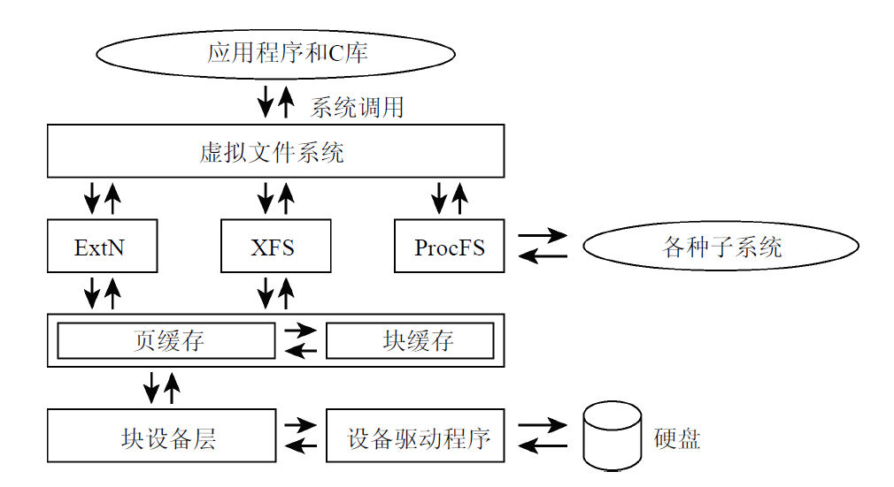
### 模块和热插拔
模块用于在运行时动态地向内核添加功能，如设备驱动程序、文件系统、网络协议等，实际上内核的任何子系统几乎都可以模块化。这消除了宏内核与微内核相比一个重要的不利之处。
模块还可以在运行时从内核卸载，这在开发新的内核组件时很有用。
模块在本质上不过是普通的程序，只是在内核空间而不是用户空间执行而已。模块必须提供某些代码段在模块初始化（和终止）时执行，以便向内核注册和注销模块。另外，模块代码与普通内核代码的权利（和义务）都是相同的，可以像编译到内核中的代码一样，访问内核中所有的函数和数据（不需要像用户程序一样使用系统调用）
对支持热插拔而言，模块在本质上是必需的。某些总线（例如，USB 和 FireWire）允许在系统运行时连接设备，而无需系统重启。在系统检测到新设备时，通过加载对应的模块，可以将必要的驱动程序自动添加到内核中。
### 缓存
内核使用缓存来改进系统性能。从低速的块设备读取的数据会暂时保持在内存中。由于内核是通过基于页的内存映射来实现访问块设备的，因此缓存也按页组织，也就是说整页都缓存起来，故称为页缓存（page cache）。
### 链表
内核提供的标准链表可用于将任何类型的数据结构彼此链接起来。它不是类型安全的。
list_head
```c
struct list_head {
	struct list_head *next, *prev;
}
```
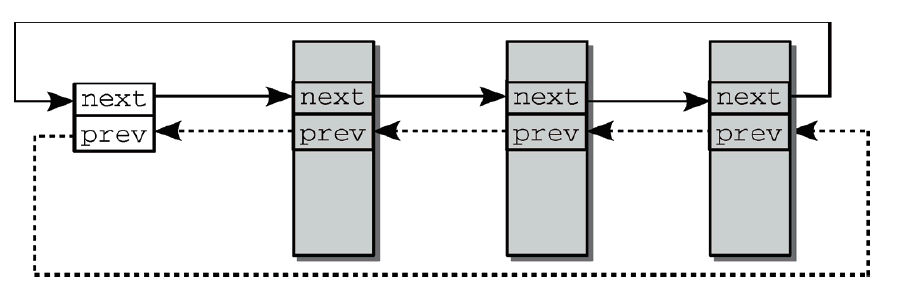

- list_add(new, head)用于现存的head元素之后，紧接着插入new元素。
- list_add_tail(new, head)用于在head元素之前，紧接着插入new元素。如果指定head为表头，由于链表是循环的，那么new元素就插入到链表的末尾（该函数因此而得名）。
- list_del(entry)从链表中删除一项。
- list_empty(head)检测链表是否为空，也就是链表是否没有包含元素。
- list_splice ( list, head)负责合并两个链表，把list插入到另一个现存链表的head元素之后。
- 查找链表元素必须使用list_entry。初看起来，其调用语法相当复杂：list_entry(ptr, type,member)。ptr是指向数据结构中list_head成员实例的一个指针，type是该数据结构的类型，而member则是数据结构中表示链表元素的成员名。如果在链表中查找task_struct的实例，则需要下列示例调用：struct task_struct = list_entry(ptr, struct task_struct,run_list)。

因为链表的实现不是类型安全的，所以需要显式指定类型。如果数据结构包含在多个链表中，则必须指定所要查找的链表元素，才能找到正确的链表元素

- list_for_each(pos, head)用于遍历链表的所有元素。pos表示链表中的当前位置，而head指定了表头。
### 对象管理和引用计数
一般的内核对象（这里也使用了面向对象的概念，虽然 C 不是面向对象的语言）需要适应以下对象操作：

- 引用计数
- 管理对象链表（集合）
- 集合加锁
- 将对象属性导出到用户空间（通过 sysfs 文件系统）
#### 一般性的内核对象
kobject.h:
```c
struct kobject
{
    const char *k_name;
    struct kref kref;
    struct list_head entry;
    struct kobject *parent;
    struct kset *kset;
    struct kobj_type *ktype;
    struct sysfs_dirent *sd;
};
```
kobject 不是通过指针与其他数据结构连接起来，而必须直接嵌入。这样做，通过管理 kobject 即达到了对包含 kobject 对象的管理。类似面向对象里的继承
```c
struct sample {
    ...
    struct kobject kobj;
    ...
};
```

- **k_name**:是对象的文本名称，可利用 sysfs 导出到用户空间。sysfs 是一个虚拟文件系统，可以将系统的各种属性描述导出到用户空间。sd 即用于支持内核对象与 sysfs 之间的关联，我会在第 10 章再详细论述。
- **kref**:类型为 struct kref，用于简化引用计数的管理。
```c
  // <kref.h>
  struct kref {
      atomic_t refcount;
  };
```
refcount是一个原子数据类型，给出了内核中当前使用某个对象的计数。在计数器到达 0 时，说明该对象已经没有其他地方使用了，，可以从内存中删除（感觉有点像 GC 内存垃圾回收）。
 “原子”在这里意味着，对该变量的加 1 和减 1 操作在多处理器系统上也是安全的(多线程安全)

- **entry**:是一个标准的链表元素，用于将若干 kobject 放置到一个链表中（在这种情况下称为集合）。
- **kset**:将对象与其他对象放置到一个集合时，则需要 kset。
- **parent**:是一个指向父对象的指针，可用于在 kobject 之间建立层次结构。
- **ktype**:提供了包含 kobject 的数据结构的更多详细信息。其中，最重要的是用于释放该数据结构资源的析构器函数。

kobject 的以上几个变量可以说是实现了类似面向对象的技术
#### 派生：kset 对象集合类
介绍下 kobject 的派生类 kset
```c
struct kset
{
    struct kobj_type *ktype;
    struct list_head list;
    ...
    struct kobject kobj;
    struct kset_uevent_ops *uevent_ops;
}
```

- **ktype**: 指向 kset 中各个内核对象公用的 kobj_type 结构。
```c
struct kobj_type
{
    struct sysfs_ops *sysfs_ops;
    struct attribute **default_attrs;
}
```

- **list**: 是所有属于当前集合的内核对象的链表。
- **uevent_ops**: 提供了若干函数指针，用于将集合的状态信息传递给用户层。该机制由驱动程序 模型的核心使用，例如格式化一个信息，通知添加了新设备。
### 数据类型
#### 类型定义
内核使用 typedef 来定义各种数据类型，以避免依赖于体系结构相关的特性，比如数据位长
#### 字节序
现代计算机采用大端序（big endian）或小端序。
内核提供了各种函数和宏，可以在 CPU 使用的格式与特定的表示法之间转换。cpu_to_le64 将 64 位数据类型转换为小端序格式，而 le64_to_cpu 所做的刚好相反
 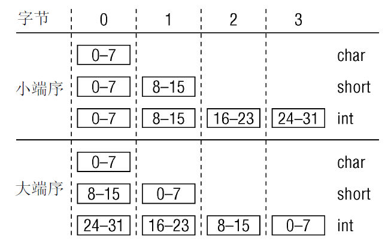
#### 访问用户空间
源代码中的多处指针都标记为__user，该标识符对用户空间程序设计是未知的。内核使用该记号来标识指向用户地址空间中区域的指针，在没有进一步预防措施的情况下，不能轻易访问这些指针指向的区域。这是因为内存是通过页表映射到虚拟地址空间的用户空间部分的，而不是由物理内存直接映射的。因此内核需要确保指针所指向的页帧确实存在于物理内存中
