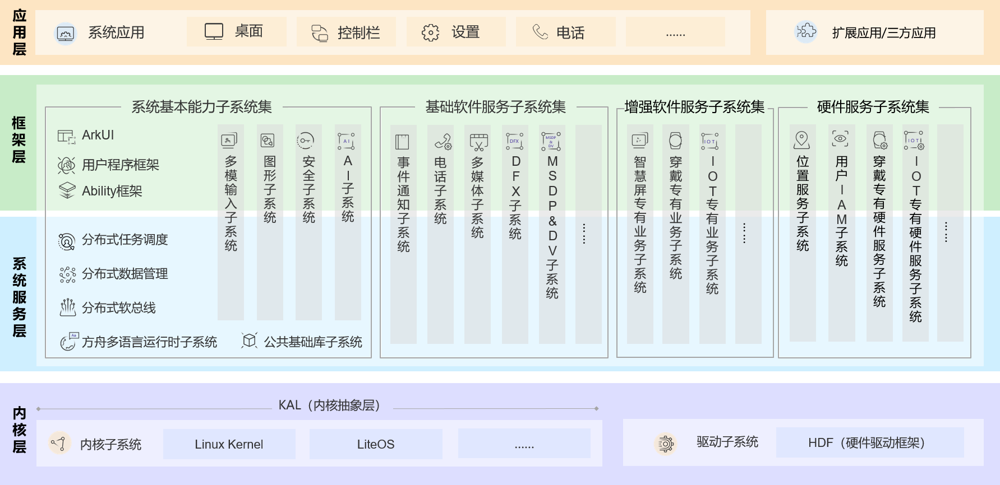

# OpenHarmony 源码下载与编译 {#openharmony}

## 概述
本文基于 WSL Ubuntu22.04进行操作。python 版本为 3.9



## 准备命令工具

安装依赖库
```shell
sudo apt install libxinerama-dev libxcursor-dev libxrandr-dev libxi-dev
```

安装 QEMU
```shell
sudo apt update
sudo apt upgrade qemu qemu-system-arm
```

本节介绍如何准备命令行工具，具体包括 git/repo/python。

OpenHarmony 代码托管在码云服务器上，下载单个代码仓通常使用 git 命令行工具，下载所有代码仓需要使用 repo 命令行工具。repo 命令行工具是由 Python 开发的，因此开始之前，需要线安装 git/git-lfs/python 等命令行工具。

安装git/git-lfs/python/curl，执行如下命令：
```shell
sudo apt install git git-lfs python3-pip curl
```

安装repo命令，执行如下命令：
```shell
mkdir ~/bin
curl https://gitee.com/oschina/repo/raw/fork_flow/repo-py3 > ~/bin/repo
pip3 install -i https://repo.huaweicloud.com/repository/pypi/simple requests
```
安装好之后需要添加可执行权限，并且配置环境变量
**注意：** 我这里使用的是 zsh 命令行工具，环境变量保存在 `.zshrc` 中，bash 的环境变量保存在 `.bashrc` 中，对应进行修改
```shell
chmod a+x ~/bin/repo
echo 'export PATH=~/bin:$PATH' >> ~/.zshrc
source ~/.zshrc
```

执行命令 `repo --version` 出现如下信息则证明安装成功
```shell
<repo not installed>
repo launcher version 2.8
       (from /home/yuh/bin/repo)
git 2.34.1
Python 3.10.12 (main, Jul 29 2024, 16:56:48) [GCC 11.4.0]
OS Linux 192.0.2.10-microsoft-standard-WSL2 (#1 SMP Thu Oct 5 21:02:42 UTC 2023)
CPU x86_64 (x86_64)
```
## 下载OpenHarmony源码

使用 https 协议下载 google

- 从版本分支获取源码。可获取该版本分支的最新源码，包括版本发布后在该分支的合入。
```shell
repo init -u https://gitee.com/openharmony/manifest -b OpenHarmony-4.0-Release --no-repo-verify
repo sync -c
repo forall -c 'git lfs pull'
```

- 从版本发布Tag节点获取源码。可获取与版本发布时完全一致的源码。
```shell
repo init -u https://gitee.com/openharmony/manifest -b refs/tags/OpenHarmony-v4.0-Release --no-repo-verify
repo sync -c
repo forall -c 'git lfs pull'
```

## 下载编译工具链

代码下载完成后，还需要执行prebuilts_download.sh脚本，下载编译工具链，执行如下命令：

```shell
bash build/prebuilts_download.sh
```
这个脚本会创建prebuilts目录，并将边回忆工具链下载、解压到这个目录下。

## 准备hb命令

编译OpenHarmony源码之前，需要先安装hb命令。

```shell
# 安装 hb 命令：
pip install build/hb
```

将以下命令添加到环境变量中 `.zshrc` | `.bashrc`
```shell
# set PATH so it includes user's private bin if it exists
if [ -d "$HOME/.local/bin" ] ; then
    PATH="$HOME/.local/bin:$PATH"
fi
```

## 编译

执行配置命令
```shell
hb set
```

选择 QEMU 的版本, 选择 mini

```shell
OHOS Which os_level do you need?  (Use arrow keys)
❯ mini
  small
  standard
```

选择 qemu_cm55_mini_system_demo

```shell
OHOS Which product do you need?  (Use arrow keys)

hisilicon
 ❯ wifiiot_hispark_pegasus
   hispark_pegasus_mini_system

ohemu
   qemu_riscv_mini_system_demo
   qemu_csky_mini_system_demo
   qemu_cm55_mini_system_demo
   qemu_xtensa_mini_system_demo
   qemu_ca7_mini_system_demo
   qemu_mini_system_demo

bearpi
   bearpi_hm_nano

chipsea
   xts_demo
   dsoftbus_demo
   iotlink_demo

goodix
   gr5515_sk_xts_demo
   gr5515_sk_iotlink_demo

beken
   xts_demo
   wifi_bk7235

talkweb
   niobe407

telink
   ota_demo
   xts_demo
   ble_demo
   led_demo
   mbedtls_demo
   uart_demo

lockzhiner
   lingpi

asrmicro
   xts_demo
   wifi_demo

hihope
```

执行编译命令
```shell
hb build -f
```

执行结果
```shell
[OHOS INFO] c targets overlap rate statistics
[OHOS INFO] subsystem           files NO.       percentage      builds NO.      percentage      overlap rate
[OHOS INFO] hiviewdfx                 12        2.4%          12        2.4%    1.00
[OHOS INFO] kernel                    57        11.6%         57        11.6%   1.00
[OHOS INFO] security                  60        12.2%         60        12.2%   1.00
[OHOS INFO] startup                   26        5.3%          26        5.3%    1.00
[OHOS INFO] systemabilitymgr          15        3.0%          15        3.0%    1.00
[OHOS INFO] thirdparty               313        63.6%        313        63.6%   1.00
[OHOS INFO]
[OHOS INFO] c overall build overlap rate: 1.00
[OHOS INFO]
[OHOS INFO]
[OHOS INFO] qemu_cm55_mini_system_demo build success
[OHOS INFO] Cost time:  0:00:27
```

## 运行
执行 `./qemu_run` 使用 qemu 模拟

运行结果如下
```shell
board: arm_mps3_an547

Enter to start qemu[y/n]:^Mentering kernel init...
Timer with period zero, disabling
Entering scheduler
OHOS # time cost: 11
TaskSampleEntry1 running...
TaskSampleEntry2 running...

OHOS #
OHOS # TaskSampleEntry1 running...
TaskSampleEntry2 running...
```

使用 `ctrl+a` 和 `x` 退出 qemu
