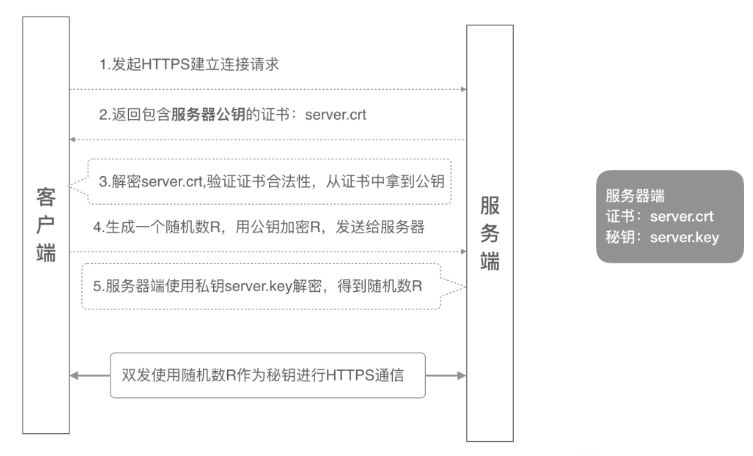
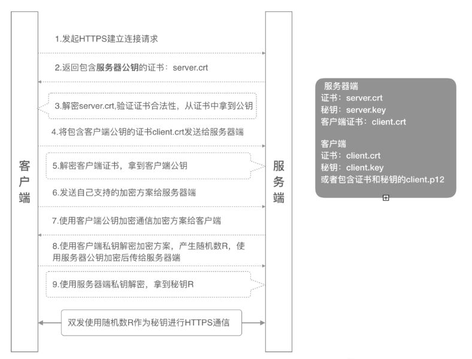

# TLS 双向认证 {#_1}

## 原理
**双向认证**(mutual authentication)，顾名思义，**客户端**和**服务器端**都需要**验证对方的身份**，在建立 HTTPS 连接的过程中，握手的流程比单向认证多了几步。
单向认证的过程，客户端从服务器端下载服务器端公钥证书进行验证，然后建立安全通信通道。
双向通信流程，客户端除了需要从服务器端下载服务器的公钥证书进行验证外，还需要把客户端的公钥证书上传到服务器端给服务器端进行验证，等双方都认证通过了，才开始建立安全通信通道进行数据传输。
## 单向认证流程(RSA)
**单向认证**流程中，服务器端保存着**公钥证书**和**私钥**两个文件，整个握手过程如下：


1. 客户端发起建立 HTTPS 连接请求，将 SSL 协议版本的信息发送给服务器端；
2. 服务器端将本机的公钥证书（server.crt）发送给客户端；
3. 客户端读取公钥证书 (server.crt)，取出了服务端公钥；
4. 客户端生成一个随机数（密钥 R），用刚才得到的服务器公钥去加密这个随机数形成密文，发送给服务端；
5. 服务端用自己的私钥 (server.key) 去解密这个密文，得到了密钥 R
6. 服务端和客户端在后续通讯过程中就使用这个密钥R进行通信了
## 双向认证流程(RSA)


1. 客户端发起建立 HTTPS 连接请求，将 SSL 协议版本的信息发送给服务端；
2. 服务器端将本机的公钥证书 (server.crt) 发送给客户端；
3. 客户端读取公钥证书 (server.crt)，取出了服务端公钥；
4. 客户端将客户端公钥证书 (client.crt) 发送给服务器端；
5. 服务器端解密客户端公钥证书，拿到客户端公钥；
6. 客户端发送自己支持的加密方案给服务器端；
7. 服务器端根据自己和客户端的能力，选择一个双方都能接受的加密方案，使用客户端的公钥加密后发送给客户端；
8. 客户端使用自己的私钥解密加密方案，生成一个随机数 R，使用服务器公钥加密后传给服务器端；
9. 服务端用自己的私钥去解密这个密文，得到了密钥 R
10. 服务端和客户端在后续通讯过程中就使用这个密钥R进行通信了。
## 签发服务器端证书

1. 使用以下命令生成无密码的2048位rsa密钥
```shell
openssl genrsa -out client.key 2048
```
或加上-des3命令生成使用des3算法加密的rsa密钥
```shell
 openssl genrsa -des3 -out client.key 2048
```

2. 生成服务器端csr文件
```shell
openssl req -new -key client.key -out client.csr
```

3. 依次填入csr信息，Common Name表示使用者，不能与颁发者相同
```shell
 Country Name (2 letter code) [AU]:CN
 State or Province Name (full name) [Some-State]:zhejiang
 Locality Name (eg, city) []:ningbo
 Organization Name (eg, company) [Internet Widgits Pty Ltd]:SX
 Organizational Unit Name (eg, section) []:tech
 Common Name (e.g. server FQDN or YOUR name) []:client1
 Email Address []:

 Please enter the following 'extra' attributes
 to be sent with your certificate request
 A challenge password []:147258369
 An optional company name []:sanxing
```

4. 使用CA签发客户端x509证书
```shell
 openssl x509 -req -days 365 -in client.csr -CA ca.crt -CAkey ca.key -set_serial 01 -out client.crt
```

5. 将客户端密钥和证书打包成pfx文件，用于浏览器或系统导入
```shell
 openssl pkcs12 -export -out client.pfx -inkey client.key -in client.crt
```
或加上CA证书保证证书被信任
```shell
 openssl pkcs12 -export -out client.pfx -inkey client.key -in client.crt -certfile ca.crt
```

## 签发客户端证书


- 服务端证书生成过程与客户端相同，此处不再赘述

## 证书部署
本次配置以GoAhead-openssl为例，GoAhead还能使用mbedtls实现https，这里不做介绍，关于GoAhead的介绍如下：
> GoAhead is the world’s most popular, tiny embedded web server. It is compact, secure and simple to use.

> GoAhead is deployed in hundreds of millions of devices and is ideal for the smallest of embedded devices.

以上步骤完成后，将会生成如下文件：
```shell
ca.key  ca.crt  client.crt  client.key  client.pfx  server.key  server.crt
```

- (可选)server.key和server.crt部署在服务器证书路径下
- 对于GoAhead，ca.crt需部署在服务器证书路径下，用于验证客户端证书
- client.pfx安装到客户端，windows下直接下一步默认即可
