# JPEG 编码原理 {#jpeg-}

## 核心流程

JPEG 是音视频领域中最常用的图片编码格式之一。其有损压缩主流程为：

1. 将图像分割成 `8 × 8` 小块；
2. 把 RGB 色彩空间转换为 YCbCr；
3. 对每个分量进行二维离散余弦变换（DCT）；
4. 对 DCT 系数量化，主动损失部分精度；
5. 通过 Zig-zag 扫描把二维矩阵转为一维序列；
6. 使用游程思想与 Huffman 编码完成熵编码。

编码过程可概括为：`DCT → 量化 → 熵编码`；解码过程则为：`熵解码 → 反量化 → IDCT`。

## 一、JPEG 有损编解码简介

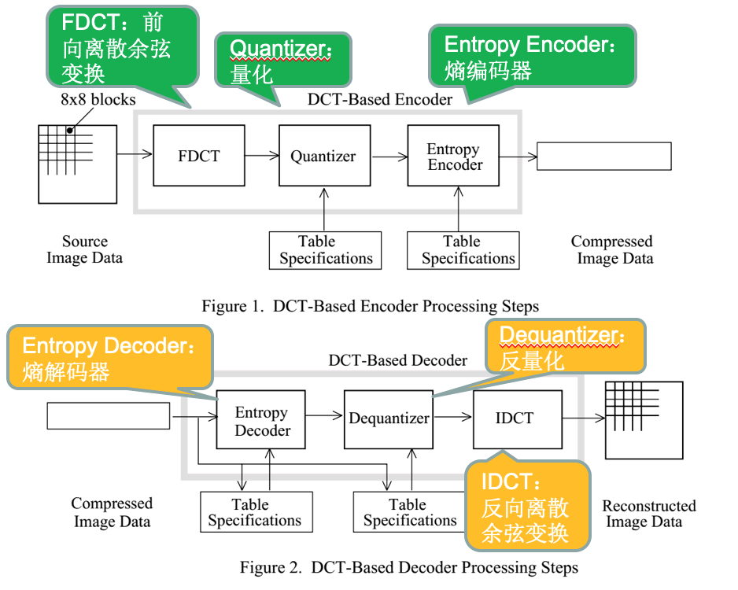

上图展示 JPEG 编解码流程。图片编码依次执行离散余弦变换、量化和熵编码；图片解码则依次执行熵解码、反量化和反向离散余弦变换。

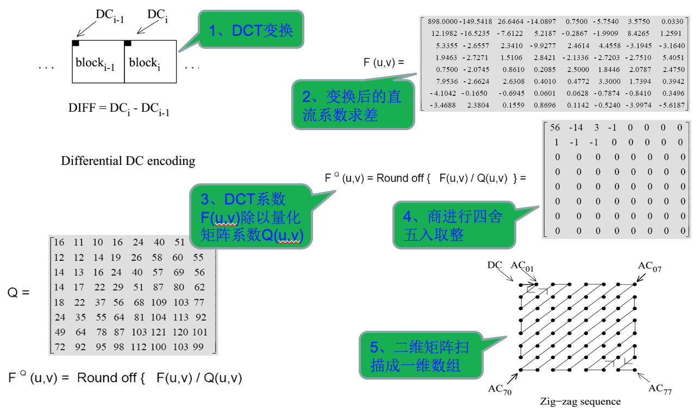

有损编码的数据损失主要发生在量化阶段，因为量化过程不可逆。

## 二、图像分割

JPEG 算法的第一步是把图像分割成多个 `8 × 8` 小块。此后，每个小块在整个压缩过程中独立处理。

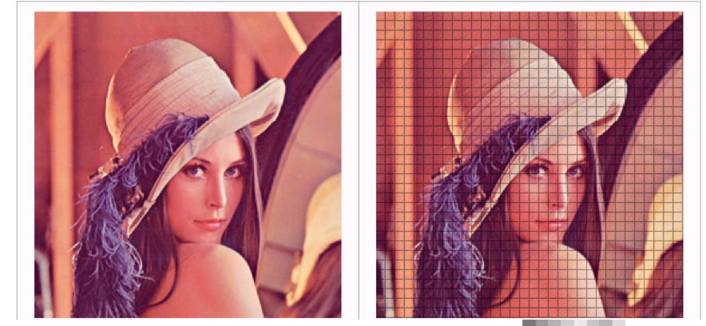

## 三、色彩空间转换

JPEG 编码的第二步是统一输入图片的色彩格式。常见的 RGB 模型把颜色分解为红、绿、蓝三个分量；一个 `8 × 8` 图块可表示为 R、G、B 三个 `8 × 8` 矩阵，元素通常位于 `[0, 255]`。

JPEG 压缩需要把图像转换为 YCbCr 模型：

- `Y`：亮度（Luminance）；
- `Cb`、`Cr`：蓝色色差与红色色差分量。

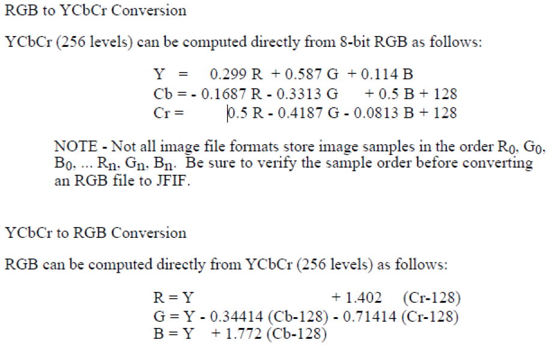

人眼对明暗变化比对颜色变化更敏感。这与视网膜上感知亮度的视杆细胞数量远多于感知颜色的视锥细胞有关。有损压缩的关键是区分重要和不重要的信息：尽量保留重要信息，适当删减不重要的信息。

YCbCr 能把亮度和色差分开，因此编码时可以重点保留人眼敏感的亮度分量，对不太敏感的色差分量允许更多损失。

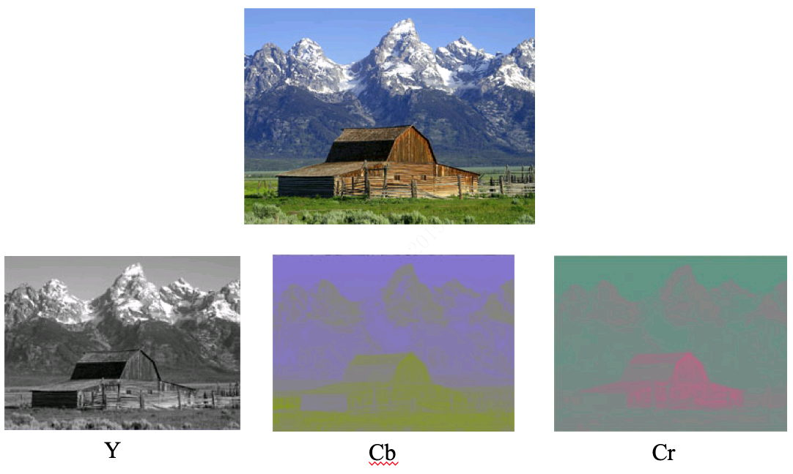

从亮度与色差分离后的图像可以明显看出，亮度图细节更加丰富。JPEG 转换到 YCbCr 后，便能按照不同分量的重要程度采取不同的压缩策略。

## 四、离散余弦变换（DCT）

离散余弦变换（Discrete Cosine Transform，DCT）是 JPEG 算法的核心。它是傅里叶变换的一种形式，能把空域信号转换到频域，具有良好的去相关性。

傅里叶提出，任何周期性函数都可以分解为一系列三角函数的组合。三角函数虽然无法精确表达带“尖角”的函数，但随着叠加项增加，可以无限逼近目标函数。

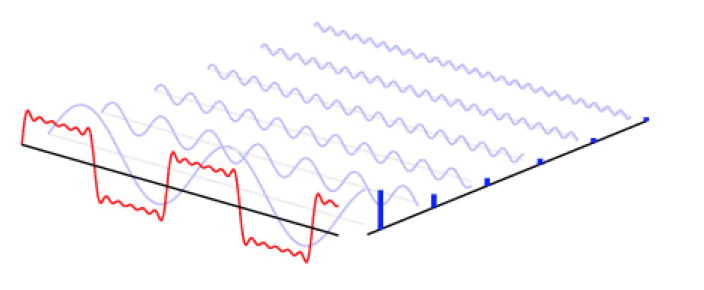

当处理对象是一组离散且对称的数据时，傅里叶变换结果只包含余弦项，这就是离散余弦变换。

> **DCT 的主要目的：**把定长的时域信号转换为频域信号，让能量集中在少数频率范围内，从而去除冗余。

例如，一个所有元素都相同的矩阵经过 DCT 后，各级数组合为一个新的矩阵：

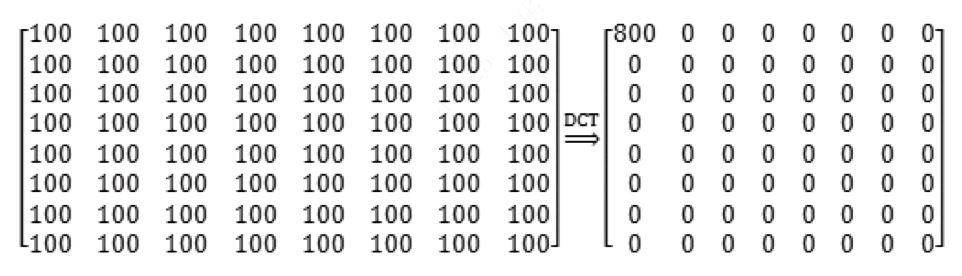

一维 DCT 变换公式如下。其中，`f(i)` 是原始信号，`F(u)` 是变换后的系数，`N` 是原始信号的点数，`c(u)` 是补偿系数，可使 DCT 变换矩阵成为正交矩阵。

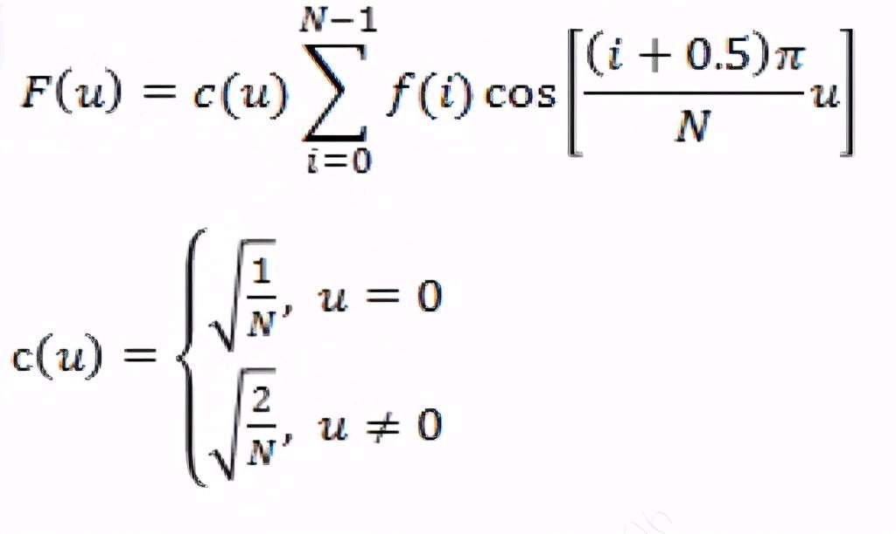

通过求出 DCT 系数，可以把一个数组分解为多个数组之和；如果把数组看作一维矩阵，结果也可以理解为一系列矩阵之和。

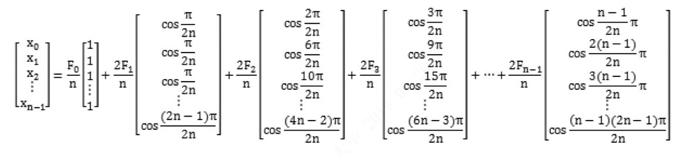

下面的例子展示离散数据 `50, 55, 67, 80, -10, -5, 20, 30` 的 DCT 变换。一维数组经过变换后，被表示为多个余弦函数的叠加。

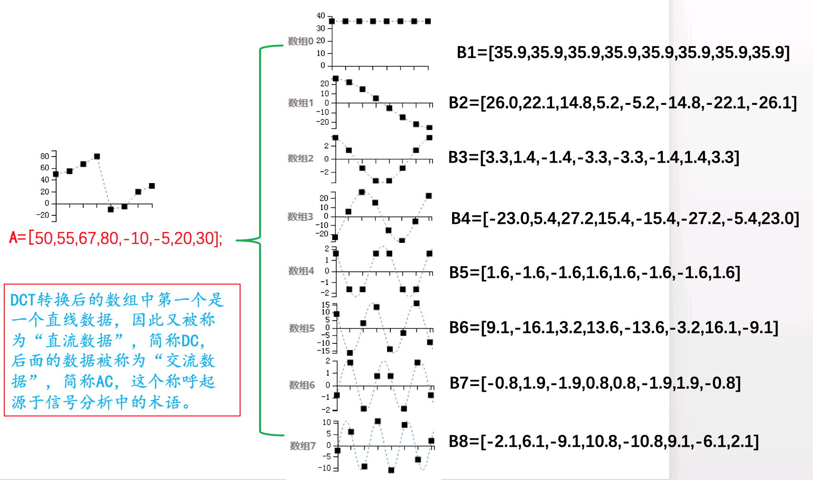

图像经过分割后形成多个 `8 × 8` 宏块，每个宏块包含 Y、Cb、Cr 三个 `8 × 8` 数据矩阵，因此实际需要执行二维 DCT。

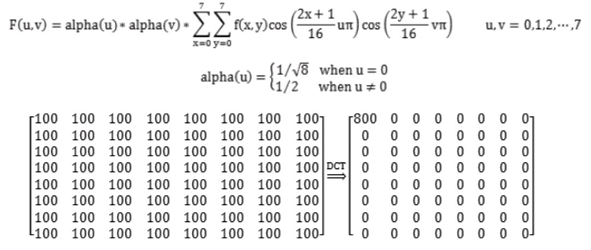

DCT 会把矩阵的能量集中到左上角的直流分量 `F(0,0)` 附近。实际图片通常具有连续性，同一个 `8 × 8` 块内的数据不会剧烈跳变，因此变换后可分为直流分量和交流分量，为后续压缩奠定基础。

DCT 本身是可逆过程：经过 IDCT 可以还原数据，不会造成信息损失。

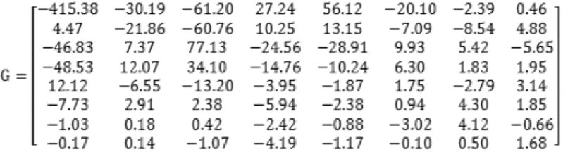

上图是一块 Y 分量经过 DCT 后的数据。系数之间的差异仍然较大；若允许损失部分精度，下一步可通过量化减少存储这些数值所需的空间。

## 五、量化

JPEG 使用如下量化算法：

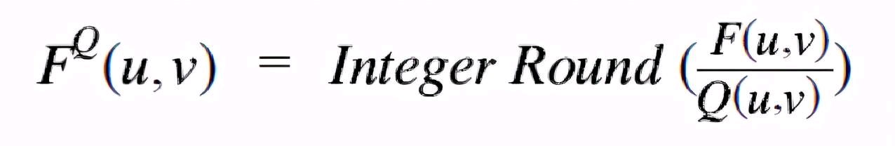

JPEG 提供两张标准量化系数矩阵，分别用于处理亮度数据 Y，以及色差数据 Cb、Cr。

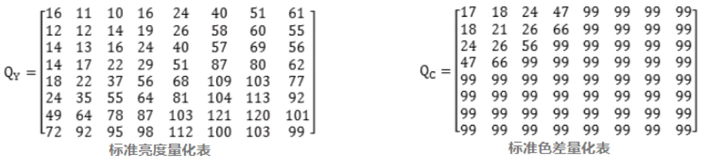

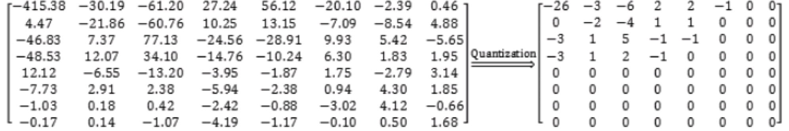

量化后，数据会更加集中，彼此之间的差异变小，为后面的熵编码消除大量冗余。不过，量化会引入精度损失：`8 × 8` 矩阵经过 DCT 和量化后，再进行反量化与 IDCT，还原结果会偏离原始数据。

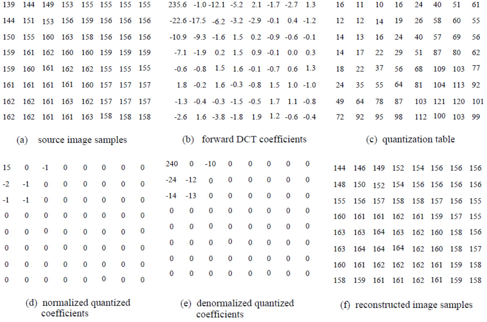

量化后需要把二维数据转换成一维数组，以便后续熵编码。JPEG 使用 Zig-zag 顺序扫描，使能量集中的低频系数排在前面，不重要的高频系数尽可能集中在后面。

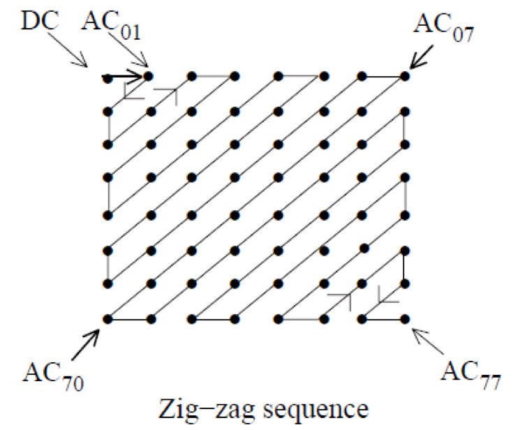

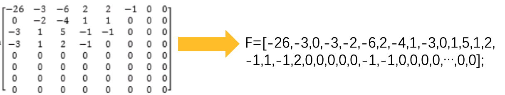

至此，图片数据已从空域转换为频域，经量化大幅去除冗余，再由 Zig-zag 扫描转换为一维数组，为熵编码做好准备。

## 六、熵编码

JPEG 的熵编码使用 Huffman coding。Huffman 编码是许多压缩算法的基础：它根据各元素的出现频率调整编码长度，让高频元素使用较短编码，从而提高压缩率。

假设量化后经 Zig-zag 扫描得到如下序列：

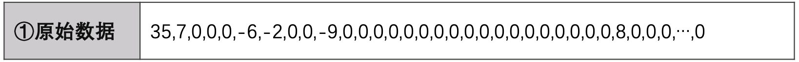

### 6.1 对连续的 0 进行处理

数据中 `0` 出现的概率很高，因此把每个非零数据与它前面连续 `0` 的个数组成一个处理单元。如果某单元前有超过 16 个 `0`，则按每 16 个一组拆分；如果序列末尾全部为 `0`，使用特殊符号 `EOB` 表示“后面的数据全是 0”。

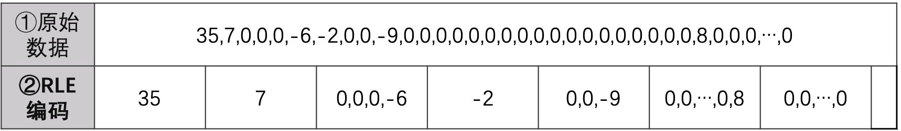

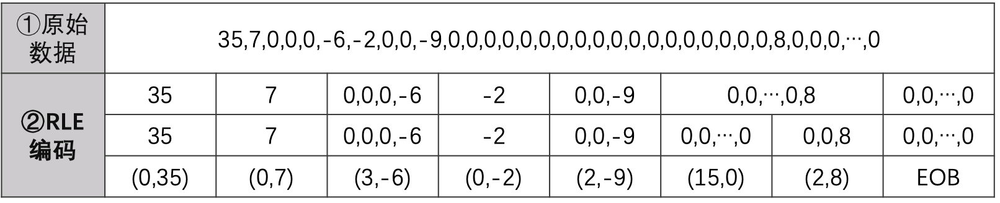

### 6.2 编码数值大小

括号右侧数字的取值范围为 `-2047～2047`。JPEG 提供标准码表对这些数字编码：

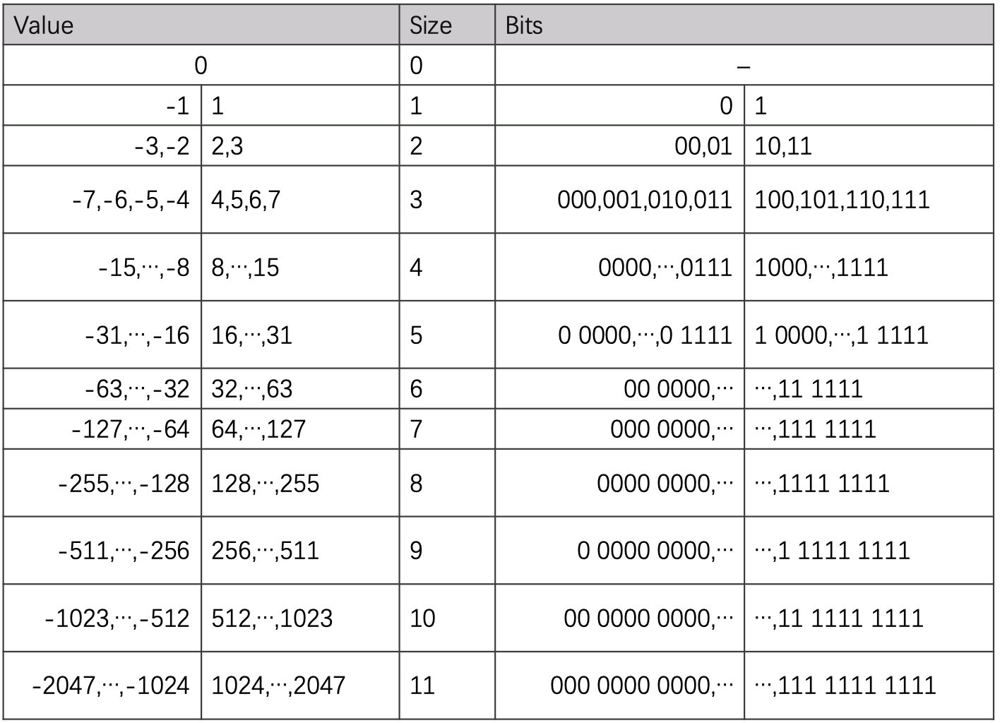

根据标准码表编码后：

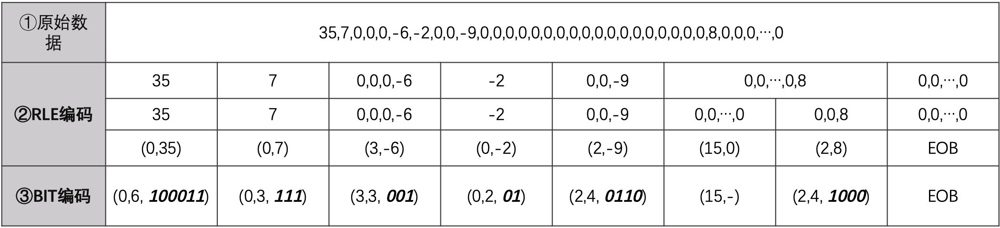

括号中的前两个数字都位于 `0～15`，因此可合并为一个 byte：高 4 位保存前置 `0` 的个数，低 4 位保存后面数值所需的位数。

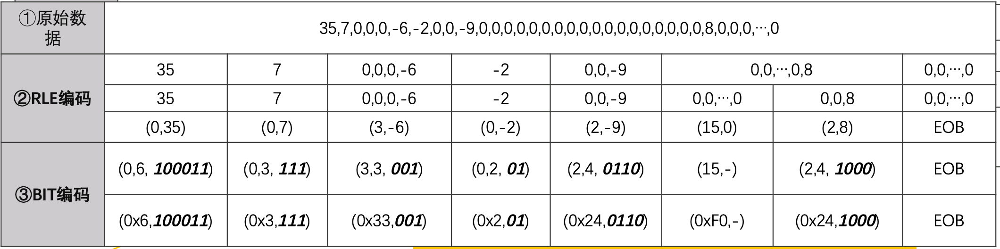

### 6.3 Huffman 编码

括号左侧的数字使用 Huffman 编码。下面是针对序列第一个单元（即直流 DC 分量）的 Huffman 表。DC 数据位于序列首位，没有前置 `0`，其取值范围为 `0～11`。

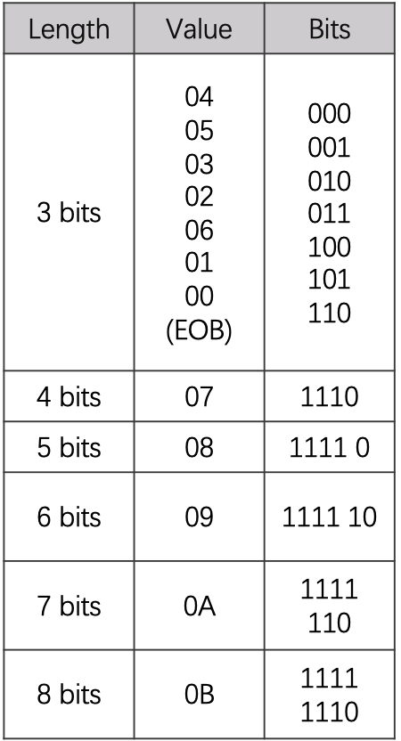

交流 AC 分量可能出现 `0`，因此高 4 位范围可为 `0x0～0xF`（最多 15 个前置 `0`），低 4 位范围为 `0～0xB`（对应码表中的 size）。其 Huffman 表如下：

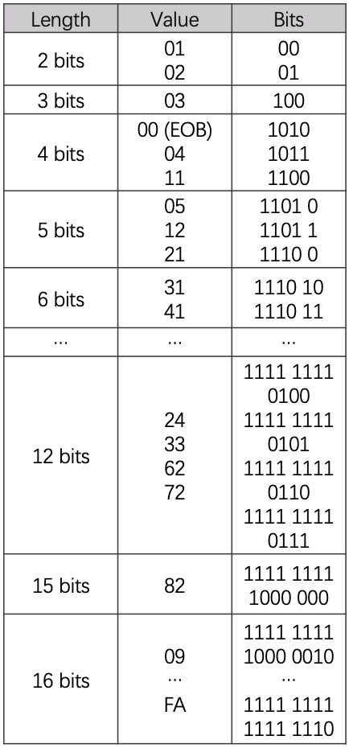

对直流和交流数据分别编码并排序后，可得到最终编码数据：

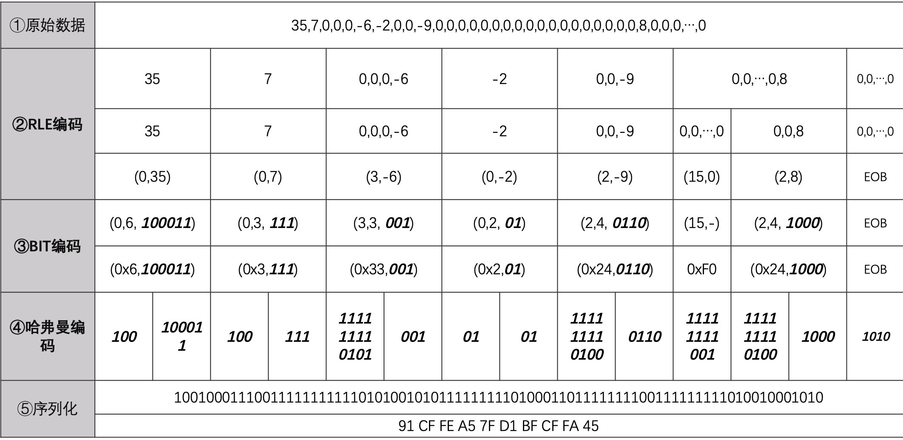

最终仅使用 10 个字节保存了原本长度为 64 的数组。至此，JPEG 的主要压缩算法结束，这些结果就是保存在 JPG 文件中的编码数据。

## 总结

- `8 × 8` 分块让 JPEG 可以对局部图像独立处理。
- YCbCr 把亮度与色差分离，便于根据人眼敏感度分配压缩精度。
- DCT 把空域数据转换到频域，并把能量集中到低频区域；此步骤可逆。
- 量化消除大量冗余，也是 JPEG 产生失真的主要环节。
- Zig-zag 扫描把低频与高频系数按顺序集中，为连续零压缩创造条件。
- 游程处理和 Huffman 编码进一步压缩数据，形成最终 JPEG 编码结果。
