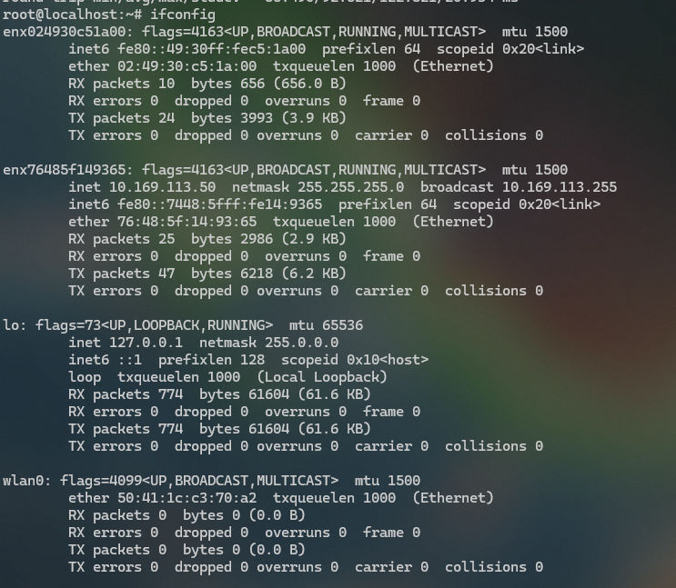

# RM500U 驱动与联网 {#rm500u}

进入AT命令
```shell
busybox microcom /dev/ttyUSB2 -s115200
```
进入串口设置之后进**多路拨号**
```shell
AT+QCFG="nat",0
OK
AT+QCFG="multiusbnet",2
OK
//手动重启模块
AT+QCFG="5glan",1,1
OK
AT+CGDCONT=1,"Ethernet","apneth",,,,,,,,,,,,,,1,"01.A70002"
OK
AT+CGDCONT=2,"IP","apnip",,,,,,,,,,,,,,1,"01.A70002"
OK
AT+QNETDEVCTL=1,1,1
OK
AT+QNETDEVCTL=2,1,1
OK
```
拨号完成之后，查看网卡情况
```shell
ifconfig
```

执行`dhclient -v enx76485f149365`尝试向 DHCP 服务器请求获取 IP 地址和其他网络配置信息。
【注意】这里只能使用多路拨号产生两个网卡才能进行联网操作，使用上述命令请求dhcp服务的时候，两个网卡都需要进行尝试，但是只有其中一个才能进行联网。
```shell
Internet Systems Consortium DHCP Client 4.4.1
Copyright 2004-2018 Internet Systems Consortium.
All rights reserved.
For info, please visit https://www.isc.org/software/dhcp/

Listening on LPF/enx76485f149365/76:48:5f:14:93:65
Sending on   LPF/enx76485f149365/76:48:5f:14:93:65
Sending on   Socket/fallback
DHCPDISCOVER on enx76485f149365 to 255.255.255.255 port 67 interval 3 (xid=0xba64690e)
DHCPOFFER of 192.0.2.10 from 192.0.2.10
DHCPREQUEST for 192.0.2.10 on enx76485f149365 to 255.255.255.255 port 67 (xid=0xe6964ba)
DHCPACK of 192.0.2.10 from 192.0.2.10 (xid=0xba64690e)
bound to 192.0.2.10 -- renewal in 33171 seconds
```
