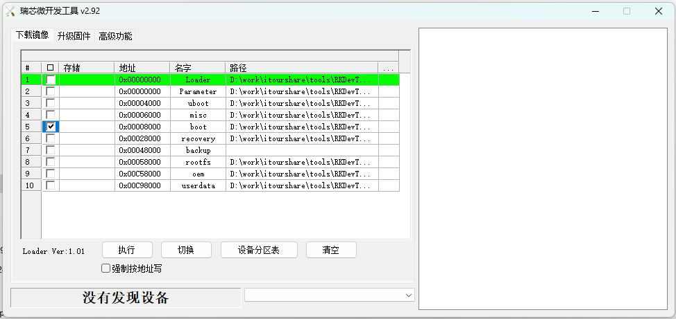

# 单独更新内核与 5G 驱动 {#linux5g}

## 1.编译Ubuntu源码
### 1.准备工作
配置环境
```shell
sudo apt update
sudo apt-get install git ssh make gcc libssl-dev liblz4-tool expect \
g++ patchelf chrpath gawk texinfo chrpath diffstat binfmt-support \
qemu-user-static live-build bison flex fakeroot cmake gcc-multilib \
g++-multilib unzip device-tree-compiler ncurses-dev
```
在泰山派官网下载[tspi_linux_sdk_repo_20240131.tar.gz](https://lceda001.feishu.cn/wiki/RcTzwNhgeiX57ckmYKPcHpunnWb)文件
执行`tar -xvf vscode-server-linux-x64.tar.gz `解压文件
执行`.repo/repo/repo sync -l -j88`将代码同步出来
【注意】这里如果报错
```shell
/usr/bin/env: "python": 没有那个文件或目录
```
可以安装python3，并创建连接解决
```shell
sudo apt install python3
sudo ln -s /usr/bin/python3 /usr/bin/python
```
同步完成之后`ls`查看目录
```shell
app        build.sh  device  envsetup.sh  kernel    mkfirmware.sh  rkbin       tools   yocto
buildroot  debian    docs    external     Makefile  prebuilts      rkflash.sh  u-boot
```

- `app`： 存放上层应⽤ app，主要是 qcamera/qfm/qplayer/settings 等⼀些应⽤程序。
- `buildroot`： 基于 buildroot (2018.02-rc3) 开发的根⽂件系统。
- `debian`： 基于debian 10 开发的根⽂件系统，⽀持部分芯⽚。
- `device/rockchip`： 存放各芯⽚板级配置和Parameter⽂件，以及⼀些编译与打包固件的脚本和预备⽂件。
- `IMAGE`： 存放每次⽣成编译时间、XML、补丁和固件⽬录。
- `external`： 存放第三⽅相关仓库,包括⾳频、视频、⽹络、recovery 等。
- `kernel`： 存放 kernel 4.4 或 4.19 开发的代码。
- `prebuilts`： 存放交叉编译⼯具链。
- `rkbin`： 存放 Rockchip 相关的 Binary 和⼯具。
- `rockdev`： 存放编译输出固件。
- `tools`： 存放 Linux 和 Windows 操作系统环境下常⽤⼯具。
- `u-boot`：存放基于 v2017.09 版本进⾏开发的 uboot 代码。
- `yocto`：基于 yocto gatesgarth 3.2 开发的根⽂件系统，⽀持部分芯⽚。
## 2.泰山派SDK板级配置
开始编译前需要先设置泰山派的板级配置
```shell
/build.sh device/rockchip/rk356x/BoardConfig-rk3566-tspi-v10.mk
```
选择3
```shell
You're building on Linux
Lunch menu...pick a combo:

0. default BoardConfig.mk
1. BoardConfig-rk3566-evb2-lp4x-v10-32bit.mk
2. BoardConfig-rk3566-evb2-lp4x-v10.mk
3. BoardConfig-rk3566-tspi-v10.mk
4. BoardConfig-rk3568-evb1-ddr4-v10-32bit.mk
5. BoardConfig-rk3568-evb1-ddr4-v10-spi-nor-64M.mk
6. BoardConfig-rk3568-evb1-ddr4-v10.mk
7. BoardConfig-rk3568-nvr-spi-nand.mk
8. BoardConfig-rk3568-nvr.mk
9. BoardConfig-rk3568-uvc-evb1-ddr4-v10.mk
10. BoardConfig.mk
Which would you like? [0]: 3
```
输出
```shell
switching to board: /home/yuh/workspace/source/240415/device/rockchip/rk356x/BoardConfig-rk3566-tspi-v10.mk
processing option: device/rockchip/rk356x/BoardConfig-rk3566-tspi-v10.mk
switching to board: /home/yuh/workspace/source/240415/device/rockchip/rk356x/BoardConfig-rk3566-tspi-v10.mk
```
查看配置是否生效
```shell
 ./build.sh -h kernel
 #输出以下信息证明配置生效
 ###Current SDK Default [ kernel ] Build Command###
cd kernel
make ARCH=arm64 rockchip_linux_defconfig 
make ARCH=arm64 tspi-rk3566-user-v10-linux.img -j12
```
```makefile
# USB驱动
CONFIG_USB_SERIAL=y
CONFIG_USB_SERIAL_WWAN=y
CONFIG_USB_SERIAL_OPTION=y
#GobiNet 驱动
CONFIG_USB_NET_DRIVERS=y
CONFIG_USB_USBNET=y
#QMI_WWAN 驱动
CONFIG_USB_NET_DRIVERS=y
CONFIG_USB_USBNET=y
CONFIG_USB_NET_QMI_WWAN=y
CONFIG_USB_WDM=y
#ACM
CONFIG_USB_ACM=y
#ECM
CONFIG_USB_NET_DRIVERS=y
CONFIG_USB_USBNET=y
CONFIG_USB_NET_CDCETHER=y
#RNDIS
CONFIG_USB_NET_DRIVERS=y
CONFIG_USB_USBNET=y
CONFIG_USB_NET_RNDIS_HOST=y
#NCM
CONFIG_USB_NET_DRIVERS=y
CONFIG_USB_USBNET=y
CONFIG_USB_NET_CDC_NCM=y
#MBIM
CONFIG_USB_NET_DRIVERS=y
CONFIG_USB_USBNET=y
CONFIG_USB_NET_CDC_MBIM=y
#PPP
CONFIG_PPP=y
CONFIG_PPP_ASYNC=y
CONFIG_PPP_SYNC_TTY=y
CONFIG_PPP_DEFLATE=y
```
以上是所有必要的配置，但是源码中有已经开启的，并且上面有重复的，所以针对本文，本次编译，所需要添加的配置实际如下
```makefile
CONFIG_USB_SERIAL_WWAN=y
CONFIG_USB_NET_DRIVERS=y
CONFIG_USB_USBNET=y
CONFIG_USB_NET_QMI_WWAN=y
CONFIG_USB_WDM=y
CONFIG_USB_NET_CDCETHER=y
CONFIG_USB_NET_RNDIS_HOST=y
CONFIG_USB_NET_CDC_NCM=y
CONFIG_PPP=y
CONFIG_PPP_ASYNC=y
CONFIG_PPP_SYNC_TTY=y
CONFIG_PPP_DEFLATE=y
```
### USB 转串口驱动
#### 添加 VID 和 PID
为了识别模块,需将模块的 VID 和 PID 信息添加到**[KERNEL]/drivers/usb/serial/option.c** 文件中
```c
static const struct usb_device_id option_ids[] = {
#if 1 //Added by Quectel
    { USB_DEVICE(0x2C7C, 0x0900) },
#endif
```
#### 添加USBNet 驱动
在**[KERNEL]/drivers/usb/serial/option.c **文件中添加以下语句:
```c
static int option_probe(struct usb_serial *serial, const struct usb_device_id *id) {
    struct usb_wwan_intf_private *data;
    //......
#if 1 //Added by Quectel
    if (serial->dev->descriptor.idVendor == cpu_to_le16(0x2C7C)) {
        __u16 idProduct = le16_to_cpu(serial->dev->descriptor.idProduct);
        struct usb_interface_descriptor *intf = &serial->interface->cur_altsetting->desc;
        if (intf->bInterfaceClass != 0xFF || intf->bInterfaceSubClass == 0x42) {
            //ECM, RNDIS, NCM, MBIM, ACM, UAC, ADB
            return -ENODEV;
        }
        if ((idProduct&0xF000) == 0x0000) {
            //MDM interface 4 is QMI
            if (intf->bInterfaceNumber == 4 && intf->bNumEndpoints == 3 &&intf->bInterfaceSubClass==0xFF&&intf->bInterfaceProtocol == 0xFF)
                return -ENODEV;
        }
    }
#endif
    /* Store device id so we can use it during attach. */
    usb_set_serial_data(serial, (void *)id);
    return 0;
}
```
#### 添加零包机制
需在**[KERNEL]/drivers/usb/serial/usb_wwan.c** 文件中添加以下语句。
```c
static struct urb *usb_wwan_setup_urb(struct usb_serial *serial, int endpoint,
                                      int dir, void *ctx, char *buf, int len,void (*callback) (struct urb *))
{
    //......
    usb_fill_bulk_urb(urb, serial->dev,
                          usb_sndbulkpipe(serial->dev, endpoint) | dir,
                          buf, len, callback, ctx);
#if 1 //Added by Quectel for zero packet
    if (dir == USB_DIR_OUT) {
        struct usb_device_descriptor *desc = &serial->dev->descriptor;
        if (desc->idVendor == cpu_to_le16(0x2C7C))
            urb->transfer_flags |= URB_ZERO_PACKET;
    }
#endif
    return urb;
}
```
#### 添加 Reset-resume 机制
在**[KERNEL]/drivers/usb/serial/option.c **文件中添加以下语句。
```c
static struct usb_serial_driver option_1port_device = {
    //......
    #ifdef CONFIG_PM
    .suspend = usb_wwan_suspend,
    .resume = usb_wwan_resume,
#if 1 //Added by Quectel
    .reset_resume = usb_wwan_resume,
#endif
    #endif
};
```
#### 增加批量输出 URB 的数量和容量
在**[KERNEL]/drivers/usb/serial/option.c **文件中添加如下语句以增加Bulk Out URB 的数量和容量,从而获得更快的上行速度。
```c
#define N_IN_URB 4
#define N_OUT_URB 4			//Increase the quantity of the bulk out URBs to 4.
#define IN_BUFLEN 4096
#define OUT_BUFLEN 4096     //Increase the capacity of the bulk out URBs to 4096.
```
### GobiNet 驱动
#### 添加驱动源码
源文件主要有
```c
GobiUSBNet.c  QMI.c  QMIDevice.c  QMIDevice.h  QMI.h  Structs.h
```
GobiNet 驱动程序由移远通信以源文件的形式提供。源文件应复制到**[KERNEL]/drivers/net/usb/**
然后添加以下语句到** [KERNEL]/drivers/net/usb/Makefile**
```makefile
obj-y += GobiNet.o
GobiNet-objs := GobiUSBNet.o QMIDevice.o QMI.o
```
### QMI_WWAN 驱动
#### 添加驱动源码
将 **qmi_wwan_q.c **复制到**[KERNEL]/drivers/net/usb/**目录下
然后添加如下语句至**[KERNEL]/drivers/net/usb/Makefile**。
```makefile
# must insert qmi_wwan_q.o before qmi_wwan.o
obj-${CONFIG_USB_NET_QMI_WWAN} += qmi_wwan_q.o
obj-${CONFIG_USB_NET_QMI_WWAN} += qmi_wwan.o
```
## 3.编译kernel
选择buildrot操作系统
```shell
export RK_ROOTFS_SYSTEM=buildroot
```
运行自动全编译命令
```shell
./build.sh kernel         # 只编译模块代码（u-Boot，kernel，Rootfs，Recovery）
                                # 需要再执⾏./mkfirmware.sh 进⾏固件打包
```
### 配置电源
配置电源


编译完成之后生成的镜像**boot.img**会位于**[source]/[KERNEL]**路径下
## 4.烧录
如果仅需更新内核驱动，则只用单独烧录kernel镜像即可

