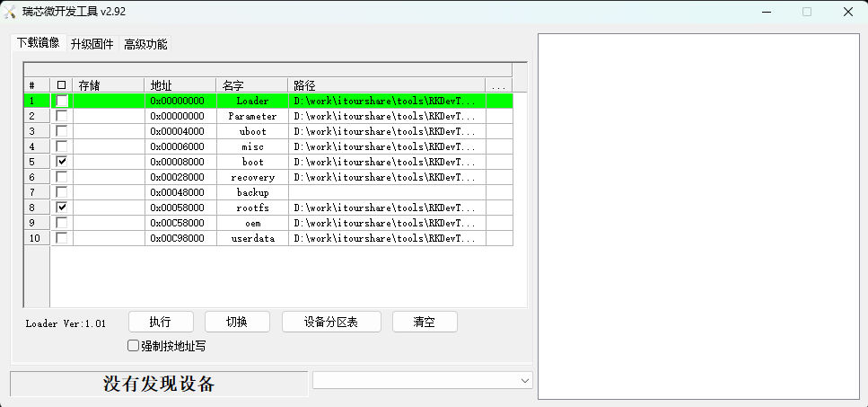

# 开发板镜像与网络验证 {#_1}

## 烧录内核镜像以及rootfs
> 烧录内核是因为需要5G驱动
> 烧录rootfs是因为需要单独的串口工具



镜像文件在**[泰山派镜像](http://192.0.2.10:1024/#/itx_share/09_%E5%85%B6%E4%BB%96/%E9%95%9C%E5%83%8F/%E6%B3%B0%E5%B1%B1%E6%B4%BE)** 路径下的**img.7z**文件里
## 扩展分区
```shell
df -h
Filesystem      Size  Used Avail Use% Mounted on
/dev/root       909M  654M  192M  78% /
devtmpfs        977M     0  977M   0% /dev
tmpfs           986M     0  986M   0% /dev/shm
tmpfs           198M  1.1M  196M   1% /run
tmpfs           5.0M  4.0K  5.0M   1% /run/lock
tmpfs           986M     0  986M   0% /sys/fs/cgroup
tmpfs           198M     0  198M   0% /run/user/0
root@localhost:~# lsblk 
NAME         MAJ:MIN RM  SIZE RO TYPE MOUNTPOINT
mmcblk0      179:0    0 14.6G  0 disk 
├─mmcblk0p1  179:1    0    4M  0 part 
├─mmcblk0p2  179:2    0    4M  0 part 
├─mmcblk0p3  179:3    0   64M  0 part 
├─mmcblk0p4  179:4    0   64M  0 part 
├─mmcblk0p5  179:5    0   32M  0 part 
├─mmcblk0p6  179:6    0    6G  0 part /
├─mmcblk0p7  179:7    0  128M  0 part 
└─mmcblk0p8  179:8    0  8.3G  0 part 
mmcblk0boot0 179:32   0    4M  1 disk 
mmcblk0boot1 179:64   0    4M  1 disk
```
因为空间比较小，无法直接安装所需要的环境，需要扩展分区
执行命令
```shell
resize2fs /dev/mmcblk0p6
```
## 网卡拨号
使用`lsusb`
```shell
Bus 006 Device 002: ID 2c7c:0900 Quectel Wireless Solutions Co., Ltd. RM500U-CNV
Bus 006 Device 001: ID 1d6b:0003 Linux Foundation 3.0 root hub
Bus 005 Device 001: ID 1d6b:0002 Linux Foundation 2.0 root hub
Bus 004 Device 002: ID 0403:6001 Future Technology Devices International, Ltd FT232 Serial (UART) IC
Bus 004 Device 001: ID 1d6b:0001 Linux Foundation 1.1 root hub
Bus 002 Device 001: ID 1d6b:0002 Linux Foundation 2.0 root hub
Bus 003 Device 001: ID 1d6b:0001 Linux Foundation 1.1 root hub
Bus 001 Device 001: ID 1d6b:0002 Linux Foundation 2.0 root hub
```
可以看到Quectel Wireless Solutions Co., Ltd. RM500U-CNV设备，就可以看到5G设备

使用`ls /dev`
```shell
block            mem                 tty12  tty5         v4l-subdev1
bus              memory_bandwidth    tty13  tty50        v4l-subdev2
cec0             mmcblk0             tty14  tty51        vcs
char             mmcblk0boot0        tty15  tty52        vcs1
console          mmcblk0boot1        tty16  tty53        vcs2
cpu_dma_latency  mmcblk0p1           tty17  tty54        vcs3
crypto           mmcblk0p2           tty18  tty55        vcs4
disk             mmcblk0p3           tty19  tty56        vcs5
dri              mmcblk0p4           tty2   tty57        vcs6
fd               mmcblk0p5           tty20  tty58        vcsa
full             mmcblk0p6           tty21  tty59        vcsa1
fuse             mmcblk0p7           tty22  tty6         vcsa2
gpiochip0        mmcblk0p8           tty23  tty60        vcsa3
gpiochip1        mmcblk0rpmb         tty24  tty61        vcsa4
gpiochip2        mpp_service         tty25  tty62        vcsa5
gpiochip3        network_latency     tty26  tty63        vcsa6
gpiochip4        network_throughput  tty27  tty7         vcsu
gpiochip5        null                tty28  tty8         vcsu1
hdmi_hdcp1x      port                tty29  tty9         vcsu2
hwrng            ppp                 tty3   ttyFIQ0      vcsu3
i2c-0            ptmx                tty30  ttyS1        vcsu4
i2c-2            pts                 tty31  ttyS3        vcsu5
i2c-3            ram0                tty32  ttyUSB0      vcsu6
i2c-4            random              tty33  ttyUSB1      vendor_storage
i2c-6            rfkill              tty34  ttyUSB2      vhci
iio:device0      rga                 tty35  ttyUSB3      video0
initctl          rtc                 tty36  ttyUSB4      video1
input            rtc0                tty37  ttyUSB5      video2
kmsg             serial              tty38  ubi_ctrl     video3
log              shm                 tty39  uhid         video4
loop-control     snd                 tty4   uinput       video5
loop0            stderr              tty40  urandom      video6
loop1            stdin               tty41  usbmon0      video7
loop2            stdout              tty42  usbmon1      video8
loop3            tee0                tty43  usbmon2      watchdog
loop4            teepriv0            tty44  usbmon3      watchdog0
loop5            tty                 tty45  usbmon4      zero
loop6            tty0                tty46  usbmon5      zram0
loop7            tty1                tty47  usbmon6
mali0            tty10               tty48  v4l
media0           tty11               tty49  v4l-subdev0
```
可以看到**ttyUSB1-5**，在此设备上的模块配置串口是**ttyUBS3**
执行以下命令进行网络配置
```shell
busybox microcom /dev/ttyUSB3 -s115200

#AT双路拨号
AT+QCFG="nat",0
OK
AT+QCFG="multiusbnet",2
OK
//手动重启模块
AT+QCFG="5glan",1,1
OK
AT+CGDCONT=1,"Ethernet","apneth",,,,,,,,,,,,,,1,"01.A70002"
OK
AT+CGDCONT=2,"IP","apnip",,,,,,,,,,,,,,1,"01.A70002"
OK
AT+QNETDEVCTL=1,1,1
OK
AT+QNETDEVCTL=2,1,1
OK
//查询通过网络同步的最新时间计算出的当前本地时间。
AT+QLTS=2

```

执行`dhclient -v enx2aa0224e0f52`
其中`enx2aa0224e0f52`是通过命令`ifconfig -a`查到的实际网卡的名字
```shell
root@localhost:~# ifconfig -a
enx2aa0224e0f52: flags=4163<UP,BROADCAST,RUNNING,MULTICAST>  mtu 1500
        inet 192.0.2.10  netmask 255.255.255.0  broadcast 192.0.2.10
        inet6 fe80::28a0:22ff:fe4e:f52  prefixlen 64  scopeid 0x20<link>
        ether 2a:a0:22:4e:0f:52  txqueuelen 1000  (Ethernet)
        RX packets 104  bytes 10380 (10.3 KB)
        RX errors 0  dropped 0  overruns 0  frame 0
        TX packets 106  bytes 10191 (10.1 KB)
        TX errors 0  dropped 0 overruns 0  carrier 0  collisions 0

enxa65d561eb9bd: flags=4163<UP,BROADCAST,RUNNING,MULTICAST>  mtu 1500
        inet6 fe80::a45d:56ff:fe1e:b9bd  prefixlen 64  scopeid 0x20<link>
        ether a6:5d:56:1e:b9:bd  txqueuelen 1000  (Ethernet)
        RX packets 10  bytes 656 (656.0 B)
        RX errors 0  dropped 0  overruns 0  frame 0
        TX packets 11  bytes 1410 (1.4 KB)
        TX errors 0  dropped 0 overruns 0  carrier 0  collisions 0

lo: flags=73<UP,LOOPBACK,RUNNING>  mtu 65536
        inet 127.0.0.1  netmask 255.0.0.0
        inet6 ::1  prefixlen 128  scopeid 0x10<host>
        loop  txqueuelen 1000  (Local Loopback)
        RX packets 192  bytes 16352 (16.3 KB)
        RX errors 0  dropped 0  overruns 0  frame 0
        TX packets 192  bytes 16352 (16.3 KB)
        TX errors 0  dropped 0 overruns 0  carrier 0  collisions 0
```
