# 泰山派 Ubuntu 镜像制作 {#ubuntu}

单独更新Linux内核而不重新编译Ubuntu的rootfs请查看[单独更新Linux内核以及添加5G驱动](单独更新内核与5G驱动.md)

## 1.编译Ubuntu源码

### 1.准备工作

配置环境

```shell
sudo apt update
sudo apt-get install git ssh make gcc libssl-dev liblz4-tool expect \
g++ patchelf chrpath gawk texinfo chrpath diffstat binfmt-support \
qemu-user-static live-build bison flex fakeroot cmake gcc-multilib \
g++-multilib unzip device-tree-compiler ncurses-dev
```

在泰山派官网下载[tspi_linux_sdk_repo_20240131.tar.gz](https://lceda001.feishu.cn/wiki/RcTzwNhgeiX57ckmYKPcHpunnWb)文件
执行`tar -xvf vscode-server-linux-x64.tar.gz `解压文件
执行`.repo/repo/repo sync -l -j88`将代码同步出来
【注意】这里如果报错

```shell
/usr/bin/env: "python": 没有那个文件或目录
```

可以安装python3，并创建连接解决

```shell
sudo apt install python3
sudo ln -s /usr/bin/python3 /usr/bin/python
```

同步完成之后`ls`查看目录

```shell
app        build.sh  device  envsetup.sh  kernel    mkfirmware.sh  rkbin       tools   yocto
buildroot  debian    docs    external     Makefile  prebuilts      rkflash.sh  u-boot
```

- `app`： 存放上层应⽤ app，主要是 qcamera/qfm/qplayer/settings 等⼀些应⽤程序。
- `buildroot`： 基于 buildroot (2018.02-rc3) 开发的根⽂件系统。
- `debian`： 基于debian 10 开发的根⽂件系统，⽀持部分芯⽚。
- `device/rockchip`： 存放各芯⽚板级配置和Parameter⽂件，以及⼀些编译与打包固件的脚本和预备⽂件。
- `IMAGE`： 存放每次⽣成编译时间、XML、补丁和固件⽬录。
- `external`： 存放第三⽅相关仓库,包括⾳频、视频、⽹络、recovery 等。
- `kernel`： 存放 kernel 4.4 或 4.19 开发的代码。
- `prebuilts`： 存放交叉编译⼯具链。
- `rkbin`： 存放 Rockchip 相关的 Binary 和⼯具。
- `rockdev`： 存放编译输出固件。
- `tools`： 存放 Linux 和 Windows 操作系统环境下常⽤⼯具。
- `u-boot`：存放基于 v2017.09 版本进⾏开发的 uboot 代码。
- `yocto`：基于 yocto gatesgarth 3.2 开发的根⽂件系统，⽀持部分芯⽚。

## 2.泰山派SDK板级配置

开始编译前需要先设置泰山派的板级配置

```shell
/build.sh device/rockchip/rk356x/BoardConfig-rk3566-tspi-v10.mk
```

选择3

```shell
You're building on Linux
Lunch menu...pick a combo:

0. default BoardConfig.mk
1. BoardConfig-rk3566-evb2-lp4x-v10-32bit.mk
2. BoardConfig-rk3566-evb2-lp4x-v10.mk
3. BoardConfig-rk3566-tspi-v10.mk
4. BoardConfig-rk3568-evb1-ddr4-v10-32bit.mk
5. BoardConfig-rk3568-evb1-ddr4-v10-spi-nor-64M.mk
6. BoardConfig-rk3568-evb1-ddr4-v10.mk
7. BoardConfig-rk3568-nvr-spi-nand.mk
8. BoardConfig-rk3568-nvr.mk
9. BoardConfig-rk3568-uvc-evb1-ddr4-v10.mk
10. BoardConfig.mk
Which would you like? [0]: 3
```

输出

```shell
switching to board: /home/yuh/workspace/source/240415/device/rockchip/rk356x/BoardConfig-rk3566-tspi-v10.mk
processing option: device/rockchip/rk356x/BoardConfig-rk3566-tspi-v10.mk
switching to board: /home/yuh/workspace/source/240415/device/rockchip/rk356x/BoardConfig-rk3566-tspi-v10.mk
```

查看配置是否生效

```shell
 ./build.sh -h kernel
 #输出以下信息证明配置生效
 ###Current SDK Default [ kernel ] Build Command###
cd kernel
make ARCH=arm64 rockchip_linux_defconfig 
make ARCH=arm64 tspi-rk3566-user-v10-linux.img -j12
```

## 3.编译buildroot

### 全编译

选择buildrot操作系统

```shell
export RK_ROOTFS_SYSTEM=buildroot
```

运行自动全编译命令

```shell
./build.sh all         # 只编译模块代码（u-Boot，kernel，Rootfs，Recovery）
                                # 需要再执⾏./mkfirmware.sh 进⾏固件打包
```

配置电源
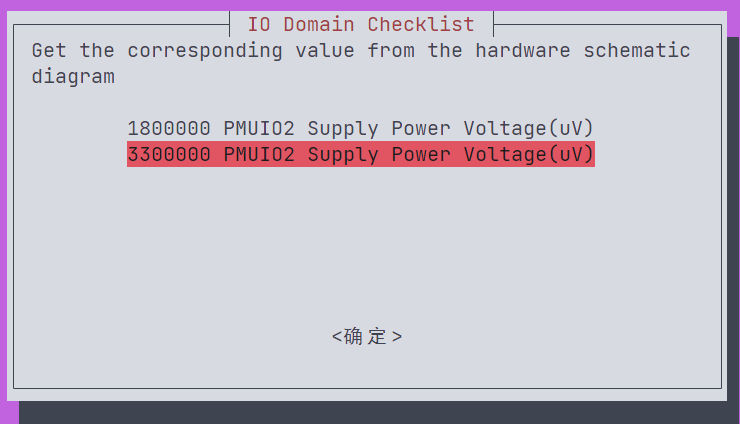
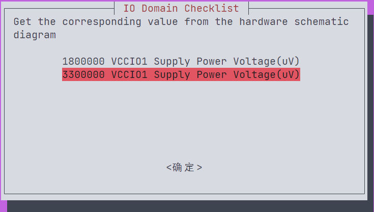
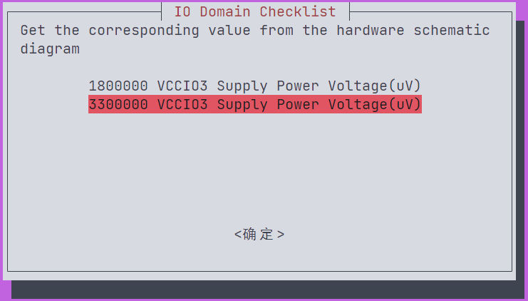
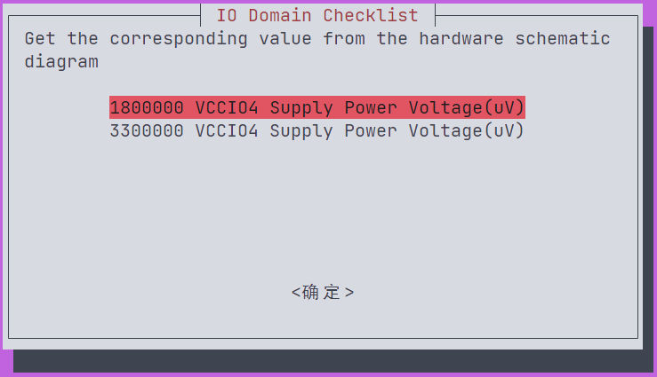
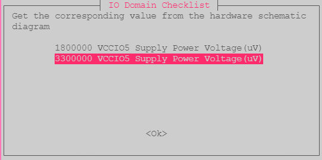
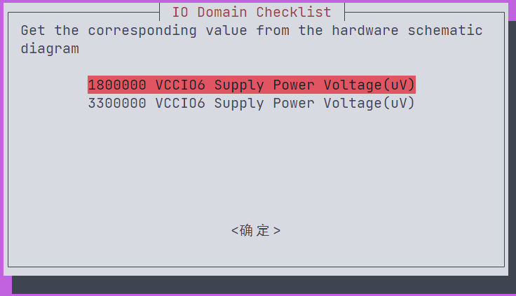
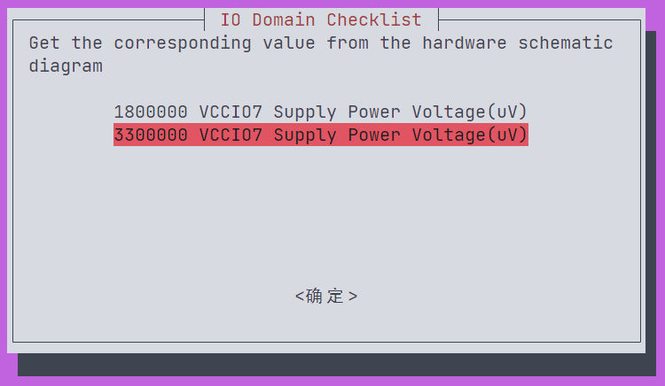

#### 错误

## 1.没有dtc

```shell
ERROR: No 'dtc', please: apt-get install device-tree-compiler
ERROR: Running build_uboot failed!
ERROR: exit code 1 from line 596:
    ./make.sh $RK_UBOOT_DEFCONFIG $UBOOT_COMPILE_COMMANDS
```

安装`device-tree-compiler`

```shell
sudo apt-get install device-tree-compiler
```

## 2.缺少python

```shell
ERROR: No python2
ERROR: Running build_uboot failed!
ERROR: exit code 1 from line 596:
    ./make.sh $RK_UBOOT_DEFCONFIG $UBOOT_COMPILE_COMMANDS
```

安装python

```shell
sudo apt-get install python2
```

## 3.找不到bc命令

```shell
.//arch/arm/mach-rockchip/fit_args.sh: line 125: bc: command not found
ERROR: Running build_uboot failed!
ERROR: exit code 255 from line 596:
    ./make.sh $RK_UBOOT_DEFCONFIG $UBOOT_COMPILE_COMMANDS
```

安装bc

```shell
sudo apt install bc
```

## 4.缺少.config文件

```shell
make: Entering directory '/home/yuh/workspace/source/240415/buildroot'
make: *** No rule to make target '/home/yuh/workspace/source/240415/buildroot/output/rockchip_rk3566/.br-external.mk'.  Stop.
make: Leaving directory '/home/yuh/workspace/source/240415/buildroot'
cp: cannot stat '/home/yuh/workspace/source/240415/buildroot/output/rockchip_rk3566/.config': No such file or directory
Done in 0s  (error code: 2)
log saved on /home/yuh/workspace/source/240415/br.log
2024-04-15T14:07:45 Makefile:7: /home/yuh/workspace/source/240415/buildroot/output/rockchip_rk3566/Makefile: No such file or directory
2024-04-15T14:07:45 make: *** No rule to make target '/home/yuh/workspace/source/240415/buildroot/output/rockchip_rk3566/Makefile'.  Stop.
Command exited with non-zero status 1
you take 0:00.89 to build builroot
ERROR: Running build_buildroot failed!
ERROR: exit code 1 from line 715:
    /usr/bin/time -f "you take %E to build builroot" $COMMON_DIR/mk-buildroot.sh $BOARD_CONFIG
```

再执行一次全编译命令

```shell
./build.sh all
```

## 5.遇到下载失败

```shell
2024-04-15T16:14:15 >>> pixman 0.40.0 Downloading
2024-04-15T16:14:15 --2024-04-15 16:14:15--  https://xorg.freedesktop.org/releases/individual/lib/pixman-0.40.0.tar.xz
2024-04-15T16:14:21 Resolving xorg.freedesktop.org (xorg.freedesktop.org)... failed: Temporary failure in name resolution.
2024-04-15T16:14:21 wget: unable to resolve host address 'xorg.freedesktop.org'
2024-04-15T16:14:21 --2024-04-15 16:14:21--  http://sources.buildroot.net/pixman-0.40.0.tar.xz
2024-04-15T16:14:22 Resolving sources.buildroot.net (sources.buildroot.net)... 192.0.2.10, 192.0.2.10, 192.0.2.10, ...
2024-04-15T16:14:23 Connecting to sources.buildroot.net (sources.buildroot.net)|192.0.2.10|:80... connected.
2024-04-15T16:14:24 HTTP request sent, awaiting response... 404 Not Found
2024-04-15T16:14:24 2024-04-15 16:14:24 ERROR 404: Not Found.
2024-04-15T16:14:24 
2024-04-15T16:14:24 make[1]: *** [package/pkg-generic.mk:140: /home/yuh/workspace/source/240415/buildroot/output/rockchip_rk3566/build/pixman-0.40.0/.stamp_downloaded] Error 1
2024-04-15T16:14:24 make: *** [/home/yuh/workspace/source/240415/buildroot/output/rockchip_rk3566/Makefile:16: _all] Error 2
Command exited with non-zero status 1
you take 29:09.44 to build builroot
ERROR: Running build_buildroot failed!
ERROR: exit code 1 from line 715:
    /usr/bin/time -f "you take %E to build builroot" $COMMON_DIR/mk-buildroot.sh $BOARD_CONFIG
```

再执行一次全编译命令

```shell
./build.sh all
```

## 6.重定义

```shell
2024-04-15T18:06:00 /usr/bin/ld: read_fs.o:(.bss+0x0): multiple definition of `fwriter_buffer'; mksquashfs.o:(.bss+0x400be8): first defined here
2024-04-15T18:06:00 /usr/bin/ld: read_fs.o:(.bss+0x8): multiple definition of `bwriter_buffer'; mksquashfs.o:(.bss+0x400bf0): first defined here
2024-04-15T18:06:00 /usr/bin/ld: action.o:(.bss+0x0): multiple definition of `fwriter_buffer'; mksquashfs.o:(.bss+0x400be8): first defined here
2024-04-15T18:06:00 /usr/bin/ld: action.o:(.bss+0x8): multiple definition of `bwriter_buffer'; mksquashfs.o:(.bss+0x400bf0): first defined here
2024-04-15T18:06:00 /usr/bin/ld: sort.o:(.bss+0x100000): multiple definition of `fwriter_buffer'; mksquashfs.o:(.bss+0x400be8): first defined here
2024-04-15T18:06:00 /usr/bin/ld: sort.o:(.bss+0x100008): multiple definition of `bwriter_buffer'; mksquashfs.o:(.bss+0x400bf0): first defined here
2024-04-15T18:06:00 /usr/bin/ld: info.o:(.bss+0x10): multiple definition of `bwriter_buffer'; mksquashfs.o:(.bss+0x400bf0): first defined here
2024-04-15T18:06:00 /usr/bin/ld: info.o:(.bss+0x8): multiple definition of `fwriter_buffer'; mksquashfs.o:(.bss+0x400be8): first defined here
2024-04-15T18:06:00 /usr/bin/ld: restore.o:(.bss+0x0): multiple definition of `fwriter_buffer'; mksquashfs.o:(.bss+0x400be8): first defined here
2024-04-15T18:06:00 /usr/bin/ld: restore.o:(.bss+0x8): multiple definition of `bwriter_buffer'; mksquashfs.o:(.bss+0x400bf0): first defined here
2024-04-15T18:06:00 /usr/bin/ld: process_fragments.o:(.bss+0x0): multiple definition of `fwriter_buffer'; mksquashfs.o:(.bss+0x400be8): first defined here
2024-04-15T18:06:00 /usr/bin/ld: process_fragments.o:(.bss+0x8): multiple definition of `bwriter_buffer'; mksquashfs.o:(.bss+0x400bf0): first defined here
2024-04-15T18:06:00 /usr/bin/ld: xattr.o:(.bss+0x8): multiple definition of `fwriter_buffer'; mksquashfs.o:(.bss+0x400be8): first defined here
2024-04-15T18:06:00 /usr/bin/ld: xattr.o:(.bss+0x10): multiple definition of `bwriter_buffer'; mksquashfs.o:(.bss+0x400bf0): first defined here
2024-04-15T18:06:00 collect2: error: ld returned 1 exit status
2024-04-15T18:06:00 make[2]: *** [Makefile:228: mksquashfs] Error 1
2024-04-15T18:06:00 make[1]: *** [package/pkg-generic.mk:231: /home/yuh/workspace/source/240415/buildroot/output/rockchip_rk3566/build/host-squashfs-3de1687d7432ea9b302c2db9521996f506c140a3/.stamp_built] Error 2
2024-04-15T18:06:00 make: *** [/home/yuh/workspace/source/240415/buildroot/output/rockchip_rk3566/Makefile:16: _all] Error 2
Command exited with non-zero status 1
you take 1:50:55 to build builroot
ERROR: Running build_buildroot failed!
ERROR: exit code 1 from line 715:
    /usr/bin/time -f "you take %E to build builroot" $COMMON_DIR/mk-buildroot.sh $BOARD_CONFIG
```

**mksquashfs.h**头文件中声明的宏，前面加上**extern**修饰符。然后把那个文件夹下面所有的.o文件都删除，再重新编译
路径在**./buildroot/output/rockchip_rk3566/build/host-squashfs-xxxx/squashfs-tools/mksquashfs.h**

```c
extern struct cache *reader_buffer, *fragment_buffer, *reserve_cache;
struct cache *bwriter_buffer, *fwriter_buffer;
extern struct queue *to_reader, *to_deflate, *to_writer, *from_writer,
*to_frag, *locked_fragment, *to_process_frag;
```

修改为

```c
extern struct cache *reader_buffer, *fragment_buffer, *reserve_cache;
extern struct cache *bwriter_buffer, *fwriter_buffer;
extern struct queue *to_reader, *to_deflate, *to_writer, *from_writer,
*to_frag, *locked_fragment, *to_process_frag;
```

**删除**`**mksquashfs.o**`**和**`**process_fragments.o**`**再执行编译**

```shell
./build.sh all
```

## 7.缺少配置文件

```shell
==========Start building recovery==========
TARGET_RECOVERY_CONFIG=rockchip_rk356x_recovery
========================================
config is rockchip_rk356x_recovery
found kernel image
Top of tree: /home/yuh/workspace/source/240415
===========================================

#TARGET_BOARD=rk356x
#OUTPUT_DIR=output/rockchip_rk356x_recovery
#CONFIG=rockchip_rk356x_recovery_defconfig

===========================================
make: Entering directory '/home/yuh/workspace/source/240415/buildroot'
make: *** No rule to make target '/home/yuh/workspace/source/240415/buildroot/output/rockchip_rk356x_recovery/.br-external.mk'.  Stop.
make: Leaving directory '/home/yuh/workspace/source/240415/buildroot'
Command exited with non-zero status 2
you take 0:00.11 to build recovery
ERROR: Running build_recovery failed!
ERROR: exit code 2 from line 858:
    /usr/bin/time -f "you take %E to build recovery" $COMMON_DIR/mk-ramdisk.sh recovery.img $RK_CFG_RECOVERY
```

执行recovery编译命令

```shell
./build.sh recovery
```

## 8.编译错误

```shell
Command exited with non-zero status 2
you take 25:11.76 to build recovery
ERROR: Running build_recovery failed!
ERROR: exit code 2 from line 858:
    /usr/bin/time -f "you take %E to build recovery" $COMMON_DIR/mk-ramdisk.sh recovery.img $RK_CFG_RECOVERY
```

同样是由于重定义引起的，但是路径是**buildroot/output/rockchip_rk356x_recovery/build/host-squashfs-xxx/squashfs-tools/mksquashfs.h，处理方式同错误6**

```c
extern struct cache *reader_buffer, *fragment_buffer, *reserve_cache;
struct cache *bwriter_buffer, *fwriter_buffer;
extern struct queue *to_reader, *to_deflate, *to_writer, *from_writer,
*to_frag, *locked_fragment, *to_process_frag;
```

**修改为**

```c
extern struct cache *reader_buffer, *fragment_buffer, *reserve_cache;
extern struct cache *bwriter_buffer, *fwriter_buffer;
extern struct queue *to_reader, *to_deflate, *to_writer, *from_writer,
*to_frag, *locked_fragment, *to_process_frag;
```

**删除**`**mksquashfs.o**`**和**`**process_fragments.o**`**再执行编译**

```shell
./build.sh all
```

## 4.Ubuntu根文件系统制作

#### 准备工作

## 安装 qemu

在 Linux PC 主机上安装模拟器：

```shell
sudo apt-get install qemu-user-static
```

## 下载和解压 ubuntu-core

下载地址：[ubuntu cdimg](http://cdimage.ubuntu.com/ubuntu-base/releases/20.04/release/) ，选择下载 ubuntu-base-20.04.1-base-arm64.tar.gz。

```shell
wget http://cdimage.ubuntu.com/ubuntu-base/releases/20.04/release/ubuntu-base-20.04.1-base-arm64.tar.gz
```

下载完之后，创建临时文件夹并解压根文件系统：

```shell
mkdir ubuntu_rootfs
tar -xpf ubuntu-base-20.04.1-base-arm64.tar.gz -C ubuntu_rootfs/ 
```

将quectel-CM文件拷贝到根文件系统中

```shell
cp quectel-CM ubuntu_rootfs/usr/bin/
```

将Payload-SDK-3.8.tar.gz文件拷贝到根文件系统中

```shell
cp Payload-SDK-3.8.tar.gz ubuntu_rootfs/root
```

#### 修改根文件系统

## 准备工作

准备网络：

```shell
cp -b /etc/resolv.conf ubuntu_rootfs/etc/resolv.conf
```

准备 qemu：

```shell
cp /usr/bin/qemu-aarch64-static ubuntu_rootfs/usr/bin/
```

## 进入根文件系统进行操作：

```shell
vim rootfs-mount.sh
```

添加代码

```shell
#!/bin/bash
 
function mnt() {
    echo "MOUNTING"
    sudo mount -t proc /proc ${2}/proc
    sudo mount -t sysfs /sys ${2}/sys
    sudo mount -o bind /dev ${2}/dev
 
    sudo chroot ${2}
}
 
function umnt() {
    echo "UNMOUNTING"
    sudo umount ${2}/proc
    sudo umount ${2}/sys
    sudo umount ${2}/dev
 
}
 
 
if [ "$1" == "-m" ] && [ -n "$2" ] ;
then
    mnt $1 $2
elif [ "$1" == "-u" ] && [ -n "$2" ];
then
    umnt $1 $2
else
    echo ""
    echo "Either 1'st, 2'nd or both parameters were missing"
    echo ""
    echo "1'st parameter can be one of these: -m(mount) OR -u(umount)"
    echo "2'nd parameter is the full path of rootfs directory(with trailing '/')"
    echo ""
    echo "For example: ch-mount -m /media/sdcard/"
    echo ""
    echo 1st parameter : ${1}
    echo 2nd parameter : ${2}
fi
```

添加权限

```shell
sudo chmod +x rootfs-mount.sh
```

进入

```shell
sudo bash rootfs-mount.sh -m ubuntu_rootfs
```

更新及安装（这个时候是在vmware 的ubuntu中虚拟机执行我们arm上的ubuntu）
换源

```shell
deb http://mirrors.tuna.tsinghua.edu.cn/ubuntu-ports/ focal main restricted 
deb http://mirrors.tuna.tsinghua.edu.cn/ubuntu-ports/ focal-updates main restricted 
deb http://mirrors.tuna.tsinghua.edu.cn/ubuntu-ports/ focal universe 
deb http://mirrors.tuna.tsinghua.edu.cn/ubuntu-ports/ focal-updates universe 
deb http://mirrors.tuna.tsinghua.edu.cn/ubuntu-ports/ focal multiverse 
deb http://mirrors.tuna.tsinghua.edu.cn/ubuntu-ports/ focal-updates multiverse 
deb http://mirrors.tuna.tsinghua.edu.cn/ubuntu-ports/ focal-backports main restricted universe multiverse
deb http://mirrors.tuna.tsinghua.edu.cn/ubuntu-ports/ focal-security main restricted 
deb http://mirrors.tuna.tsinghua.edu.cn/ubuntu-ports/ focal-security universe 
deb http://mirrors.tuna.tsinghua.edu.cn/ubuntu-ports/ focal-security multiverse
```

更新

```shell
apt-get update
apt upgrade
```

预制功能

```shell
apt install sudo vim udev net-tools ethtool udhcpc netplan.io language-pack-en-base language-pack-zh-han* iputils-ping openssh-sftp-server  ntp usbutils alsa-utils libmtp9 wpasupplicant ifupdown wireless-tools minicom xterm
```

【备注】安装过程中会提示配置地区和时区
（1）亚洲地区选择“6，Asia”
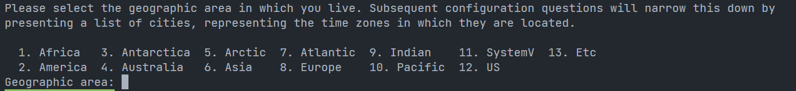
（2）中国时区选择：70，Shanghai
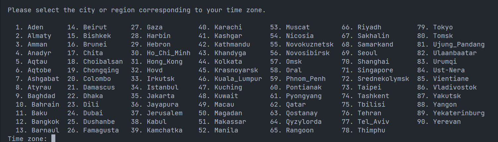
安装 lubuntu-desktop：(如果不需要界面可以不执行这一步)

```shell
apt install lubuntu-desktop
```

## 卸载一些不必要的软件

```shell
apt-get remove --purge lubuntu-update-notifier 
apt-get remove --purge libreoffice* 
```

## 添加用户

```shell
# 添加用户
adduser ubuntu   
# 添加管理权限
adduser ubuntu sudo  
```

## 串口自动登录

```shell
vim /lib/systemd/system/serial-getty\@.service
```

注释：**ExecStart=-/sbin/agetty -o ‘-p – \u’ --keep-baud 115200,38400,9600 %I $TERM
**修改：**ExecStart=-/sbin/agetty --autologin root --noclear %I $TERM
**最后关闭自动休眠

```shell
sudo systemctl mask sleep.target suspend.target hibernate.target hybrid-sleep.target
```

## 添加分区释放的系统服务(重要)

通过实验，rootfs分区烧录后，只有固件本身大小，需要做分区释放

```shell
vim etc/init.d/resize2fs.sh
```

```shell
#!/bin/bash -e
# resize filesystem mmcblk0p6
if [ ! -e "/usr/local/boot_flag" ] ;
then
  echo "Resizing /dev/mmcblk0p6..."
  resize2fs /dev/mmcblk0p6
touch /usr/local/boot_flag
fi
```

添加执行权限

```shell
chmod +x etc/init.d/resize2fs.sh
```

创建服务去运行脚本

```shell
vim lib/systemd/system/resize2fs.service
```

```shell
#start
[Unit]
Description=Setup rockchip platform environment
Before=lightdm.service
After=resize-helper.service
[Service]
Type=simple
ExecStart=/etc/init.d/resize2fs.sh
[Install]
WantedBy=multi-user.target
#end
```

## 添加环境变量配置

```shell
vim ~/.bashrc
```

```shell
resize2fs /dev/mmcblk0p6
resize -s `tput lines` `tput cols`
export TERM=xterm-256color
```

退出根文件系统

```shell
exit
```

卸载根文件系统

```shell
./rootfs-mount.sh -u ubuntu_rootfs
```

## 制作文件系统rootfs分区固件

创建一个空镜像文件
注意这里根据你自己的文件大小来`sudo du -h --max-depth=1
`制作自己的根文件系统，大小依据自己的根文件系统而定，注意依据 temp 文件夹的大小来修改 count 值，因为我们这里的大小为655M所以count=1024*bs=1M保证大于我们的ubuntu_rootfs**

```shell
dd if=/dev/zero of=ubuntu_rootfs.img bs=1M count=3072
```

将该文件格式化为ext4文件系统

```shell
mkfs.ext4 ubuntu_rootfs.img
```

将镜像文件挂载到空文件

```shell
mkdir ubuntu_base_rootfs
chmod 777 ubuntu_base_rootfs
sudo mount ubuntu_rootfs.img ubuntu_base_rootfs
sudo cp -rfp ubuntu_rootfs/* ubuntu_base_rootfs/
sudo umount ubuntu_base_rootfs/
```

修复及检测镜像文件系统

```shell
e2fsck -p -f ubuntu_rootfs.img
```

resize2fs减小镜像文件的大小，上述的释放rootfs分区大小与这里减少文件大小相关

```shell
resize2fs -M ubuntu_rootfs.img
```

查看大小

```shell
du -sh ubuntu_rootfs.img
```

## 5.分散烧录

先将之前打包的img文件更新
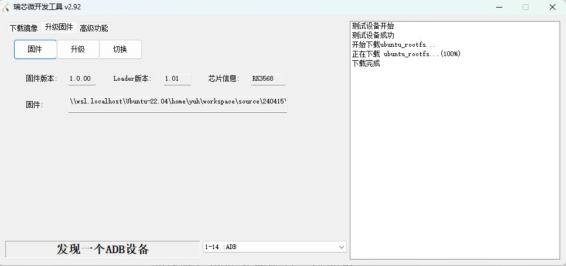
这里选择值卡打包的buildroot制作好的img文件更新内核，然后再选择下载镜像
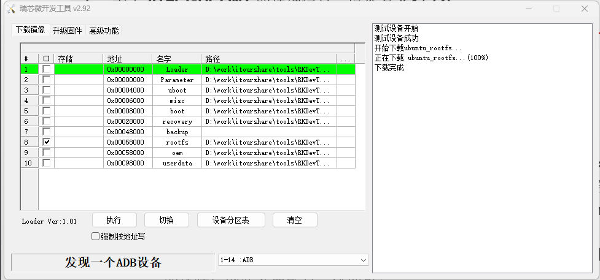
更新rootfs

## 6.配置WiFi驱动

需要将编译好的buildroot中的
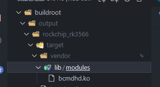
**buildroot/output/rockchip_rk3566/target/vendor/lib/modules/bcmdhd.ko**文件
以及
原本Ubuntu系统下的**/vendor**文件夹以及**/system/etc/firmware**压缩并拷贝到新的操作系统下，并放到对应位置下，执行命令

```shell
insmod bcmdhd.ko
```

## 7.打包镜像

将生成的rootfs镜像文件拷贝到RK3566源码文件夹下的rockdev，并重命名为rootfs.img

```shell
cp xxx.img xxx/rockdev/rootfs.img
```

切换到泰山派RK3566源码文件夹下执行打包命令

```shell
./build.sh updateimg
```
