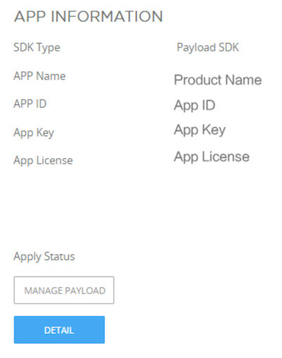

# PSDK 的 Linux 环境 {#psdklinux}

## 1.配置编译环境
1. 连接WiFi命令
```shell
wpa_supplicant -B -i wlan0 -c <(wpa_passphrase "itourshare2" "its@2021") && dhclient wlan0
```

2. 换源
```shell
# 默认注释了源码镜像以提高 apt update 速度，如有需要可自行取消注释
deb https://mirrors.tuna.tsinghua.edu.cn/ubuntu-ports/ focal main restricted universe multiverse
# deb-src https://mirrors.tuna.tsinghua.edu.cn/ubuntu-ports/ focal main restricted universe multiverse
deb https://mirrors.tuna.tsinghua.edu.cn/ubuntu-ports/ focal-updates main restricted universe multiverse
# deb-src https://mirrors.tuna.tsinghua.edu.cn/ubuntu-ports/ focal-updates main restricted universe multiverse
deb https://mirrors.tuna.tsinghua.edu.cn/ubuntu-ports/ focal-backports main restricted universe multiverse
# deb-src https://mirrors.tuna.tsinghua.edu.cn/ubuntu-ports/ focal-backports main restricted universe multiverse

deb http://ports.ubuntu.com/ubuntu-ports/ focal-security main restricted universe multiverse
# deb-src http://ports.ubuntu.com/ubuntu-ports/ focal-security main restricted universe multiverse

# 预发布软件源，不建议启用
# deb https://mirrors.tuna.tsinghua.edu.cn/ubuntu-ports/ focal-proposed main restricted universe multiverse
# # deb-src https://mirrors.tuna.tsinghua.edu.cn/ubuntu-ports/ focal-proposed main restricted universe multiverse
```

3. 安装 `cmake`、`gcc`&`g++`
```shell
sudo apt-get install -f libc6-dev=2.31-0ubuntu9.14
sudo apt-get install cmake gcc g++
```

4. 获取大疆PSDK源码
```shell
wget https://github.com/dji-sdk/Payload-SDK/archive/refs/tags/3.8.tar.gz
```

5. 解压并尝试编译
```shell
tar -xvf Payload-SDK-3.8.tar.gz
```
```shell
cd Payload-SDK-3.8
mkdir build && cd build
cmake ..
```
输出如下
```shell
-- The C compiler identification is GNU 9.4.0
-- The CXX compiler identification is GNU 9.4.0
-- Check for working C compiler: /usr/bin/cc
-- Check for working C compiler: /usr/bin/cc -- works
-- Detecting C compiler ABI info
-- Detecting C compiler ABI info - done
-- Detecting C compile features
-- Detecting C compile features - done
-- Check for working CXX compiler: /usr/bin/c++
-- Check for working CXX compiler: /usr/bin/c++ -- works
-- Detecting CXX compiler ABI info
-- Detecting CXX compiler ABI info - done
-- Detecting CXX compile features
-- Detecting CXX compile features - done
-- Cannot Find OPUS
-- Cannot Find LIBUSB
-- Did not find OpenCV in the system, image data is inside RecvContainer as raw data
-- Found FFMPEG installed in the system
--  - Includes: /usr/include/aarch64-linux-gnu
--  - Libraries: /usr/lib/aarch64-linux-gnu/libavcodec.so;/usr/lib/aarch64-linux-gnu/libavformat.so;/usr/lib/aarch64-linux-gnu/libavutil.so;/usr/lib/aarch64-linux-gnu/libswscale.so
--  - Version:  4.2.7-0ubuntu0.1
-- Cannot Find OPUS
-- Cannot Find LIBUSB
-- Configuring done
-- Generating done
-- Build files have been written to: /root/Payload-SDK-3.8/build
```
```shell
make
```
能成功输出如下编译信息，环境就配置好了
```shell
[100%] Linking CXX executable ../../../../../bin/dji_sdk_demo_linux_cxx
-- Cannot Find OPUS
-- Cannot Find LIBUSB
-- Did not find OpenCV in the system, image data is inside RecvContainer as raw data
-- Found FFMPEG installed in the system
--  - Includes: /usr/include/aarch64-linux-gnu
--  - Libraries: /usr/lib/aarch64-linux-gnu/libavcodec.so;/usr/lib/aarch64-linux-gnu/libavformat.so;/usr/lib/aarch64-linux-gnu/libavutil.so;/usr/lib/aarch64-linux-gnu/libswscale.so
--  - Version:  4.2.7-0ubuntu0.1
-- Cannot Find OPUS
-- Cannot Find LIBUSB
-- Configuring done
-- Generating done
-- Build files have been written to: /root/Payload-SDK-3.8/build
[100%] Built target dji_sdk_demo_linux_cxx
```
## 2.配置大疆开发者账号
在 [注册](https://developer.dji.com/payload-sdk/apply/)成为 DJI PSDK 的企业用户后，即可下载 DJI PSDK 开发包，在 PSDK 开发包中获取 DJI 提供的示例代码，借助示例代码了解使用 PSDK 开发负载设备的方法，使用示例代码快速开发出功能完善的出负载设备。
### 创建负载应用
获取使用 PSDK 开发负载产品的[权限open in new window](https://developer.dji.com/payload-sdk/apply) 后，请在[用户中心open in new window](https://developer.dji.com/user/apps/#all) 创建负载应用，获取应用 ID 和应用秘钥，如 图. 填写应用信息 所示。

### 运行 Linux 示例代码
#### 补充应用信息

- 在 **samples/sample_c/platform/linux/manifold2/application/dji_sdk_app_info.h** 文件中替换应用的名称、ID、Key、License、开发者账号和指定波特率。
```c
#define USER_APP_NAME               "your_app_name"
#define USER_APP_ID                 "your_app_id"
#define USER_APP_KEY                "your_app_key"
#define USER_APP_LICENSE            "your_app_license"
#define USER_DEVELOPER_ACCOUNT      "your_developer_account"
#define USER_BAUD_RATE              "460800"
```

- 在 **samples/sample_c/platform/linux/manifold2/hal/hal_uart.h** 文件的 LINUX_UART_DEV1和 LINUX_UART_DEV2 宏中填写对应的串口名称。
```
#define LINUX_UART_DEV1    "/dev/your_com"
#define LINUX_UART_DEV2    "/dev/your_com"
```

- 通过`ifconfig`命令，查看当前与无人机通讯的网口设备名称，并填写到**samples/sample_c/platform/linux/manifold2/hal/hal_network.h **文件的 **LINUX_NETWORK_DEV **宏中。
```
#define LINUX_NETWORK_DEV    "your_network_name"
```
#### 编译示例程序
**编译示例代码**
进入示例代码工程的根目录下：Payload-SDK/，使用如下命令将示例代码编译为示例程序。

1. mkdir build
2. cd build
3. cmake ..
4. make

根目录位置说明
```
Payload-SDK/
├── CMakeLists.txt
├── EULA.txt
├── LICENSE.txt
├── README.md
├── build/
├── doc/
├── psdk_lib/
├── samples/
└── tools/
```

- **执行 C 语言示例程序**
   - 进入示例程序的目录： cd build/bin/
   - 使用sudo ./dji_sdk_demo_linux命令运行示例程序
- **执行 C++ 语言示例程序**
   - 进入示例程序的目录： cd build/bin/
   - 使用sudo ./dji_sdk_demo_linux_cxx命令运行示例程序
