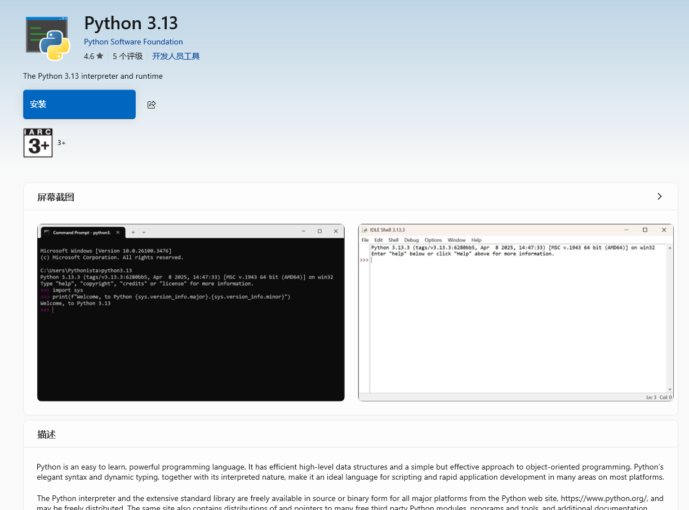

# ML307C 气表开发环境 {#_1}
## 概述
ML307C 编译依赖 `scons`，安装 `scons` 需要 Python 环境的支持
## 安装 python
直接在微软商店安装 python


安装完成之后，使用终端查看 python 版本号，执行命令 `python --version`
执行结果如下
```bash
Python 3.13.3
```
则证明 python 环境安装成功

## 安装 scons
在终端中执行命令 `pip install scons` 安装 `scons`
执行结果如下所示
```bash
Defaulting to user installation because normal site-packages is not writeable
Collecting scons
  Downloading scons-4.9.1-py3-none-any.whl.metadata (9.0 kB)
Downloading scons-4.9.1-py3-none-any.whl (4.1 MB)
   ━━━━━━━━━━━━━━━━━━━━━━━━━━━━━━━━━━━━━━━━ 4.1/4.1 MB 1.6 MB/s eta 0:00:00
Installing collected packages: scons
  WARNING: The scripts scons-configure-cache.exe, scons.exe and sconsign.exe are installed in 'C:\Users\yuh\AppData\Local\Packages\PythonSoftwareFoundation.Python.3.13_qbz5n2kfra8p0\LocalCache\local-packages\Python313\Scripts' which is not on PATH.
  Consider adding this directory to PATH or, if you prefer to suppress this warning, use --no-warn-script-location.
Successfully installed scons-4.9.1
```

根据提示将路径添加到环境变量
```bash
WARNING: The scripts scons-configure-cache.exe, scons.exe and sconsign.exe are installed in 'C:\Users\yuh\AppData\Local\Packages\PythonSoftwareFoundation.Python.3.13_qbz5n2kfra8p0\LocalCache\local-packages\Python313\Scripts' which is not on PATH.
```

执行 `scons -v`，输出如下则表明安装成功
```bash
SCons by Steven Knight et al.:
        SCons: v4.9.1.39a12f34d532ab2493e78a7b73aeab2250852790, Thu, 27 Mar 2025 11:44:24 -0700, by bdbaddog on M1Dog2021
        SCons path: ['C:\\Users\\yuh\\AppData\\Local\\Packages\\PythonSoftwareFoundation.Python.3.13_qbz5n2kfra8p0\\LocalCache\\local-packages\\Python313\\site-packages\\SCons']
Copyright (c) 2001 - 2025 The SCons Foundation
```
## 配置 vscode 终端

安装好之后，需要在 vscode 的终端中配置环境变量以访问 `scons`
找到 `settings.json` 文件，添加以下部分代码
```json
"terminal.integrated.env.windows": {
"PATH":"C:\\Users\\yuh\\AppData\\Local\\Packages\\PythonSoftwareFoundation.Python.3.13_qbz5n2kfra8p0\\LocalCache\\local-packages\\Python313\\Scripts\\"
}
```
添加完成之后，重新打开新的终端，执行 `scons -v` 查看输出
```bash
SCons by Steven Knight et al.:
        SCons: v4.9.1.39a12f34d532ab2493e78a7b73aeab2250852790, Thu, 27 Mar 2025 11:44:24 -0700, by bdbaddog on M1Dog2021
        SCons path: ['C:\\Users\\yuh\\AppData\\Local\\Packages\\PythonSoftwareFoundation.Python.3.13_qbz5n2kfra8p0\\LocalCache\\local-packages\\Python313\\site-packages\\SCons']
Copyright (c) 2001 - 2025 The SCons Foundation
```
输出以上信息即表示成功

## 编译命令
在项目路径下执行 `scons custom_main=y` 进行编译
执行 `scons custom_main=yh -c` 进行清除
